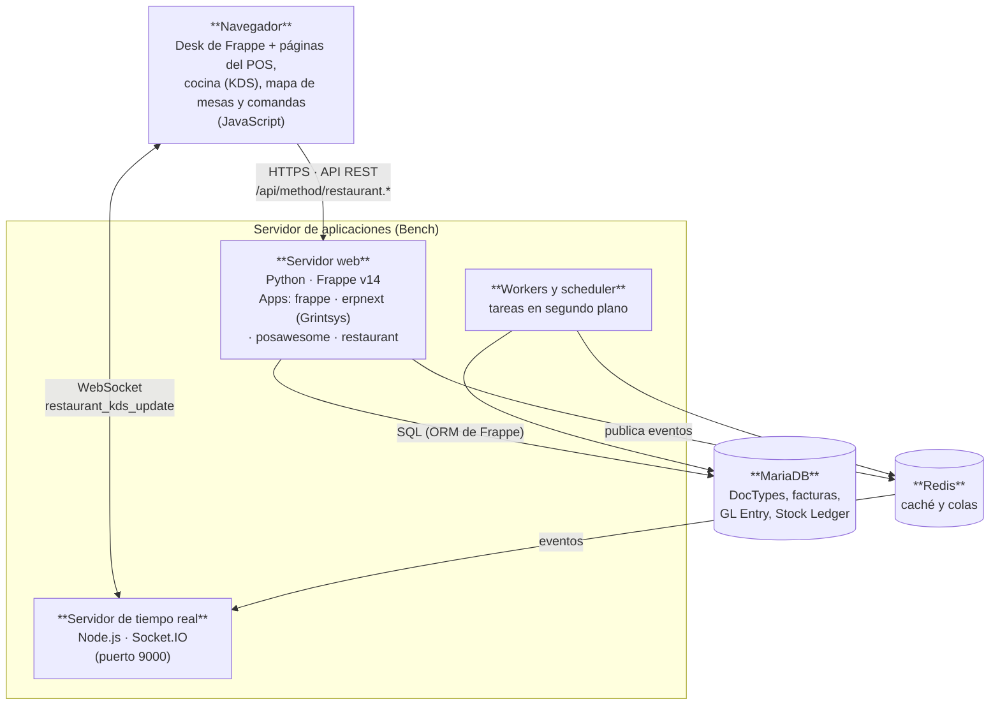

# Arquitectura del módulo Restaurante

**Proyecto:** Módulo Restaurante para LEAF ERP v14 (Grintsys)
**Última revisión:** 20/11/2026 (semana 6)
**Decisiones registradas:** [`docs/decisiones/`](decisiones/)

El módulo es una *Custom App* de Frappe llamada `restaurant`. Orquesta la operación de salón, cocina y caja, y delega en ERPNext todo lo transaccional: facturación, impuestos, contabilidad, inventario y numeración fiscal. La regla del proyecto es **reutilizar lo nativo y crear solo lo que no existe**.

---

## 1. Contexto

Quién usa el sistema y con qué sistemas externos se comunica.


## 2. Contenedores

Las piezas que se ejecutan por separado y cómo se comunican.



| Contenedor | Tecnología | Responsabilidad |
| :--- | :--- | :--- |
| Navegador | JavaScript (páginas Desk de Frappe) | Mostrar pantallas, recoger datos y llamar a la API. No decide reglas de negocio ni calcula montos fiscales. |
| Servidor web | Python 3.11, Frappe v14 | API (`@frappe.whitelist`), reglas de negocio y acceso a datos. |
| Tiempo real | Node.js, Socket.IO | Avisar a cocina y a las pantallas de estado sin recargar. Si este servicio no corre, la pantalla de cocina requiere F5 (hallazgo S5-P1-02). |
| MariaDB | Base de datos relacional | Persistencia de todos los documentos. |
| Redis | Caché y colas | Caché, colas de trabajo y canal de eventos hacia Socket.IO. |

## 3. Las tres capas en este stack

| Capa | Qué contiene en el proyecto | Ejemplos |
| :--- | :--- | :--- |
| **Presentación** | Páginas y formularios en JavaScript, y los endpoints `@frappe.whitelist` que reciben pedidos | `restaurant/restaurant/page/restaurant_pos/restaurant_pos.js`, `restaurant_kds.js`, `public/js/item_restaurant_list.js`; endpoints `save_pos_order`, `pay_and_invoice_order` |
| **Negocio** | Reglas y casos de uso del restaurante, más el motor transaccional de ERPNext | `validate_order` (totales e impuesto obligatorio), `pos_auth.py` (PIN de supervisor), `invoice_events.py` (reabrir la orden al anular), `tax_configuration.py`, `order_operations.py`, `cash_count.py`; en ERPNext: `SalesInvoice` (CAI, ISV, GL, inventario) |
| **Datos** | DocTypes (esquema en JSON), ORM de Frappe y MariaDB | `restaurant/restaurant/doctype/*` (Restaurant Order, Restaurant Table, Restaurant Cash Count…); documentos nativos Sales Invoice, GL Entry, Stock Ledger Entry |

**Regla de dependencias:** la pantalla llama a la API; la API llama al caso de uso; el caso de uso usa el ORM. Ninguna regla de negocio se decide solo en JavaScript: el navegador puede mostrar un total estimado, pero el servidor lo recalcula siempre.

Reglas que ya se movieron a su capa durante la semana 6:

- La **tasa de impuesto** de cada producto ya no se adivina en el menú por el nombre de la plantilla: la resuelve el servidor con la búsqueda nativa de ERPNext ([decisión 001](decisiones/001-impuestos-nativos-por-producto-y-grupo.md)).
- Los **totales** de una orden facturada ya no se calculan por separado: la factura es la fuente de verdad ([decisión 002](decisiones/002-factura-como-fuente-de-verdad.md)).

## 4. Estructura de carpetas

### Estructura actual (por funcionalidad)

Desde la semana 7, el antiguo `pos.py` (4,016 líneas) quedó separado por funcionalidad (issue #27). `pos.py` conserva solo el arranque del POS y vuelve a exponer cada función con su misma dirección `restaurant.pos.<nombre>`, para que la pantalla y los hooks no cambien.

```text
apps/restaurant/
├── restaurant/
│   ├── pos.py                   # Arranque del POS (get_pos_bootstrap) y direcciones públicas
│   ├── pos_context.py           # Contexto compartido: usuario, empresa, sucursal, turno
│   ├── pos_auth.py              # Roles, PIN de supervisor y bitácora de auditoría
│   ├── cash/shift.py            # Caja: abrir turno, movimientos de efectivo y cierre
│   ├── pos_settings/            # Configuración del POS por perfil y estaciones de cocina y bar
│   ├── catalog/                 # Menú y precios (menu.py) e ISV de cada producto (taxes.py)
│   ├── orders/                  # Órdenes: validación, serialización, servicio y cambios
│   ├── checkout/                # Cobro: factura, descuentos, inventario, cuentas, combos y extras
│   ├── kds.py                   # Pantalla de cocina y etapas de preparación
│   ├── order_operations.py      # Dividir, transferir y fusionar cuentas
│   ├── cash_count.py            # Arqueo de caja
│   ├── invoice_events.py        # Ciclo de vida de la factura nativa
│   ├── tax_configuration.py     # Plantillas fiscales nativas por empresa
│   ├── dashboard.py             # Datos del tablero (solo lectura)
│   ├── restaurant/doctype/      # DocTypes propios (capa de datos)
│   ├── restaurant/page/         # Pantallas: POS, cocina, mesas, comandas y tablero
│   ├── restaurant/report/       # Reportes (Ventas por Mesero y Modalidad)
│   └── tests/                   # Pruebas automáticas (FrappeTestCase y Node)
└── docs/                        # Arquitectura, decisiones, pruebas y bitácoras
```

### Diccionario de nombres del código

El código va en inglés (regla del proyecto); este es su significado:

| Carpeta o archivo | Significado | Qué contiene |
| :--- | :--- | :--- |
| `pos_context.py` | Contexto del punto de venta | Quién es el usuario, su empresa, su sucursal y su turno |
| `cash/shift.py` | Caja / turno | Apertura, movimientos de efectivo, vista previa y cierre |
| `pos_settings/config.py` | Configuración del POS | Ajustes por perfil, pantalla de reposo y autopedido |
| `pos_settings/stations.py` | Estaciones | Cocina, bar e impresión de comandas |
| `catalog/menu.py` | Catálogo / menú | Categorías, productos y precios de venta |
| `catalog/taxes.py` | Impuestos del catálogo | ISV de cada producto (15 %, 18 % o exento) |
| `orders/validation.py` | Validación de órdenes | Revisar que la orden esté correcta y el estado de la mesa |
| `orders/serialization.py` | Datos de la orden | Lo que la pantalla necesita de cada orden y las mesas en vivo |
| `orders/service.py` | Servicio de órdenes | Guardar, enviar a cocina, precuenta, reimpresión y autopedido |
| `orders/changes.py` | Cambios a órdenes | Transferir, dividir, anular productos, vaciar y desbloquear |
| `checkout/invoice.py` | Cobro / factura | Cobrar y emitir la factura de venta nativa |
| `checkout/combos.py` | Combos | Componentes del combo que salen del inventario (decisión 003) |
| `checkout/discounts.py` | Descuentos | Límites y autorización del supervisor |
| `checkout/stock.py` | Inventario | Revisión de existencias antes de facturar |
| `checkout/accounts.py` | Cuentas | Cuentas contables y datos fiscales SAR |
| `checkout/extras.py` | Extras del cobro | Cupones, certificados, puntos, correo, WhatsApp y recibo |
| `dashboard.py` | Tablero | Cifras del tablero del gerente |

### Pendiente

La pantalla del POS (`restaurant/page/restaurant_pos/restaurant_pos.js`, unas 6,750 líneas) sigue en un solo archivo. Separarla por funcionalidad es el siguiente paso, con el mismo criterio.

Frappe exige que los DocTypes vivan en `restaurant/restaurant/doctype/`, así que la separación aplica al código Python de negocio y a las pantallas. Cada paso se protege con la suite de pruebas automáticas.
