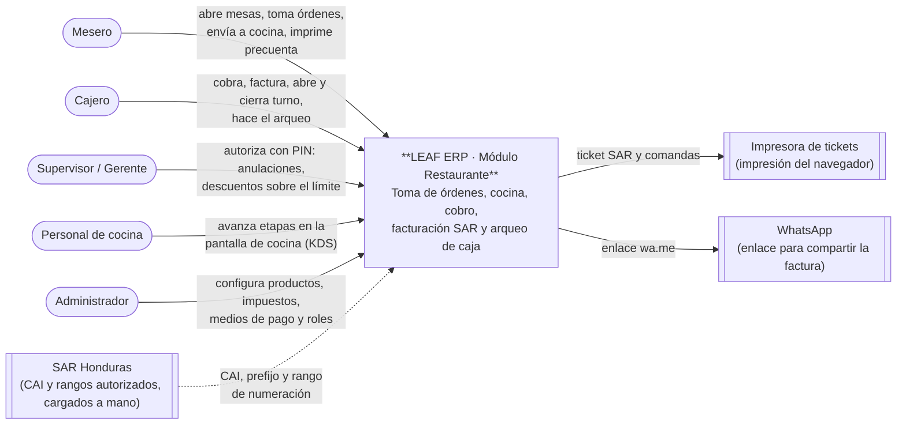
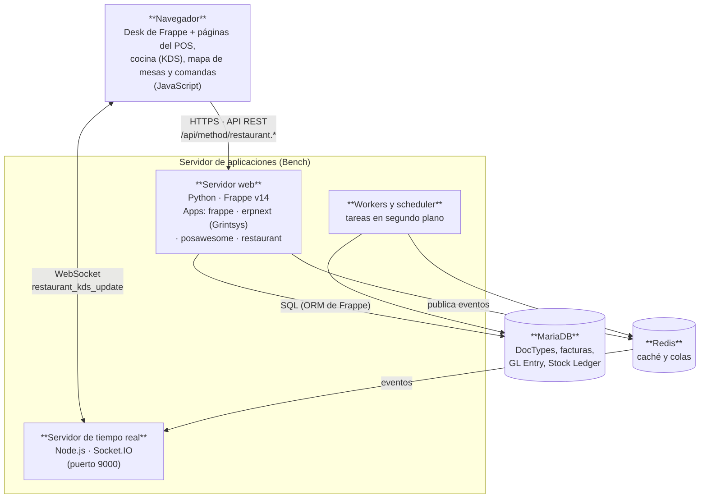

# Arquitectura del módulo Restaurante

**Proyecto:** Módulo Restaurante para LEAF ERP v14 (Grintsys)
**Última revisión:** 20/11/2026 (semana 6)
**Decisiones registradas:** [`docs/decisiones/`](decisiones/)

El módulo es una *Custom App* de Frappe llamada `restaurant`. Orquesta la operación de salón, cocina y caja, y delega en ERPNext todo lo transaccional: facturación, impuestos, contabilidad, inventario y numeración fiscal. La regla del proyecto es **reutilizar lo nativo y crear solo lo que no existe**.

---

## 1. Contexto

Quién usa el sistema y con qué sistemas externos se comunica.



## 2. Contenedores

Las piezas que se ejecutan por separado y cómo se comunican.



| Contenedor | Tecnología | Responsabilidad |
| :--- | :--- | :--- |
| Navegador | JavaScript (páginas Desk de Frappe) | Mostrar pantallas, recoger datos y llamar a la API. No decide reglas de negocio ni calcula montos fiscales. |
| Servidor web | Python 3.11, Frappe v14 | API (`@frappe.whitelist`), reglas de negocio y acceso a datos. |
| Tiempo real | Node.js, Socket.IO | Avisar a cocina y a las pantallas de estado sin recargar. Si este servicio no corre, la pantalla de cocina requiere F5 (hallazgo S5-P1-02). |
| MariaDB | Base de datos relacional | Persistencia de todos los documentos. |
| Redis | Caché y colas | Caché, colas de trabajo y canal de eventos hacia Socket.IO. |

## 3. Las tres capas en este stack

| Capa | Qué contiene en el proyecto | Ejemplos |
| :--- | :--- | :--- |
| **Presentación** | Páginas y formularios en JavaScript, y los endpoints `@frappe.whitelist` que reciben pedidos | `restaurant/restaurant/page/restaurant_pos/restaurant_pos.js`, `restaurant_kds.js`, `public/js/item_restaurant_list.js`; endpoints `save_pos_order`, `pay_and_invoice_order` |
| **Negocio** | Reglas y casos de uso del restaurante, más el motor transaccional de ERPNext | `validate_order` (totales e impuesto obligatorio), `pos_auth.py` (PIN de supervisor), `invoice_events.py` (reabrir la orden al anular), `tax_configuration.py`, `order_operations.py`, `cash_count.py`; en ERPNext: `SalesInvoice` (CAI, ISV, GL, inventario) |
| **Datos** | DocTypes (esquema en JSON), ORM de Frappe y MariaDB | `restaurant/restaurant/doctype/*` (Restaurant Order, Restaurant Table, Restaurant Cash Count…); documentos nativos Sales Invoice, GL Entry, Stock Ledger Entry |

**Regla de dependencias:** la pantalla llama a la API; la API llama al caso de uso; el caso de uso usa el ORM. Ninguna regla de negocio se decide solo en JavaScript: el navegador puede mostrar un total estimado, pero el servidor lo recalcula siempre.

Reglas que ya se movieron a su capa durante la semana 6:

- La **tasa de impuesto** de cada producto ya no se adivina en el menú por el nombre de la plantilla: la resuelve el servidor con la búsqueda nativa de ERPNext ([decisión 001](decisiones/001-impuestos-nativos-por-producto-y-grupo.md)).
- Los **totales** de una orden facturada ya no se calculan por separado: la factura es la fuente de verdad ([decisión 002](decisiones/002-factura-como-fuente-de-verdad.md)).

## 4. Estructura de carpetas

### Estructura actual

```text
apps/restaurant/
├── restaurant/
│   ├── hooks.py                 # Integración con Frappe/ERPNext (doc_events, fixtures)
│   ├── pos.py                   # Punto de venta: órdenes, cobro, catálogo, configuración
│   ├── kds.py                   # Pantalla de cocina y etapas de preparación
│   ├── order_operations.py      # Dividir, transferir y fusionar cuentas
│   ├── cash_count.py            # Arqueo de caja
│   ├── pos_auth.py              # Roles, PIN de supervisor y bitácora de auditoría
│   ├── invoice_events.py        # Ciclo de vida de la factura nativa
│   ├── tax_configuration.py     # Plantillas fiscales nativas por empresa
│   ├── gift_certificates.py     # Certificados de regalo nativos de Grintsys
│   ├── table_management.py      # Mesas y mapa del salón
│   ├── restaurant/doctype/      # DocTypes propios (capa de datos)
│   ├── restaurant/page/         # Pantallas del POS, cocina, mesas y comandas
│   ├── restaurant/report/       # Reportes (Ventas por Mesero y Modalidad)
│   └── tests/                   # Pruebas automáticas (FrappeTestCase)
└── docs/                        # Arquitectura, decisiones, pruebas y bitácoras
```

La mayoría de los módulos ya está organizada **por funcionalidad** (cocina, caja, mesas, fiscal). La excepción es `pos.py`, de más de 4,000 líneas, que mezcla órdenes, cobro, catálogo y configuración.

### Estructura meta

Separar `pos.py` por funcionalidad, sin cambiar el comportamiento ni los nombres de los endpoints que usa el JavaScript:

```text
restaurant/
├── ordenes/        # validación y guardado de órdenes, precuenta
├── cobro/          # facturación, pagos, descuentos y propina
├── catalogo/       # menú, precios e impuestos por producto
├── configuracion/  # configuración del POS por perfil
└── ...             # cocina, caja, mesas y fiscal se mantienen
```

Frappe exige que los DocTypes vivan en `restaurant/restaurant/doctype/`, así que la separación aplica al código Python de negocio. Este trabajo está planificado para una fase posterior, protegido por la suite de pruebas automáticas.
