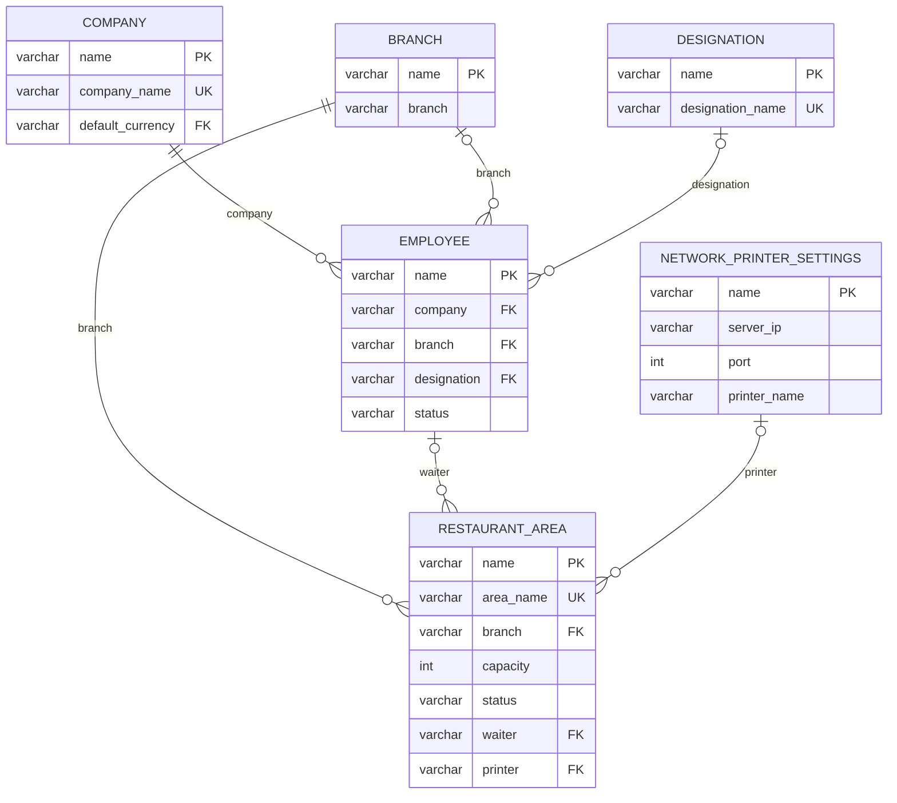
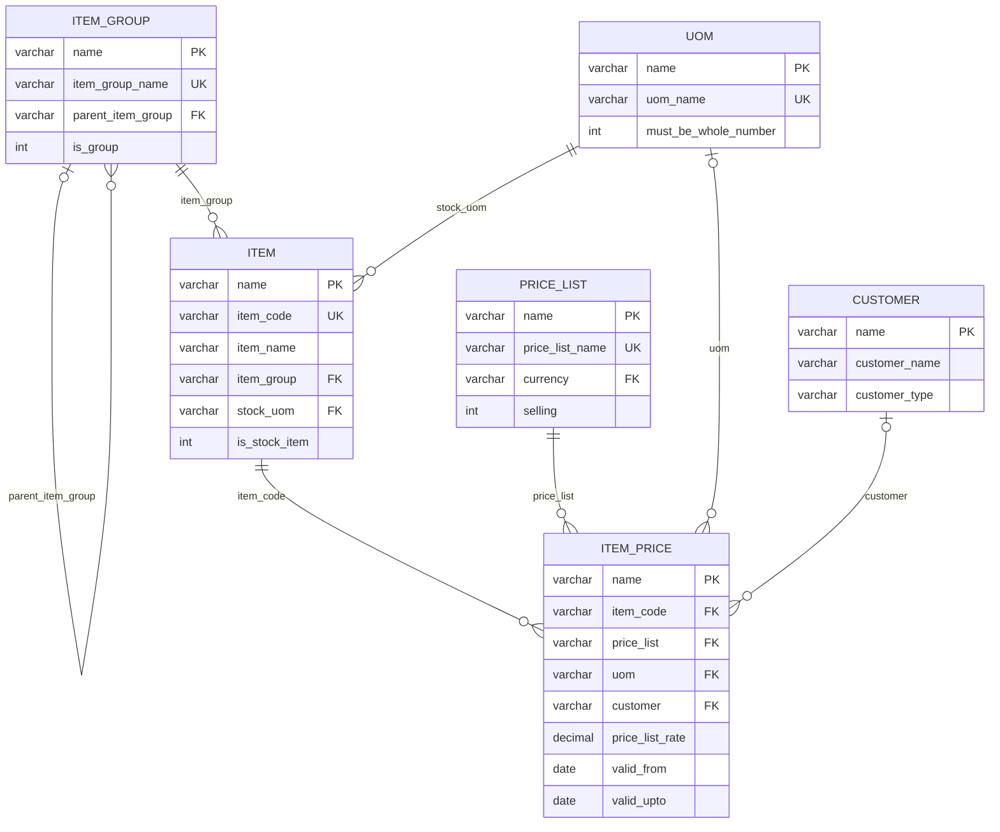
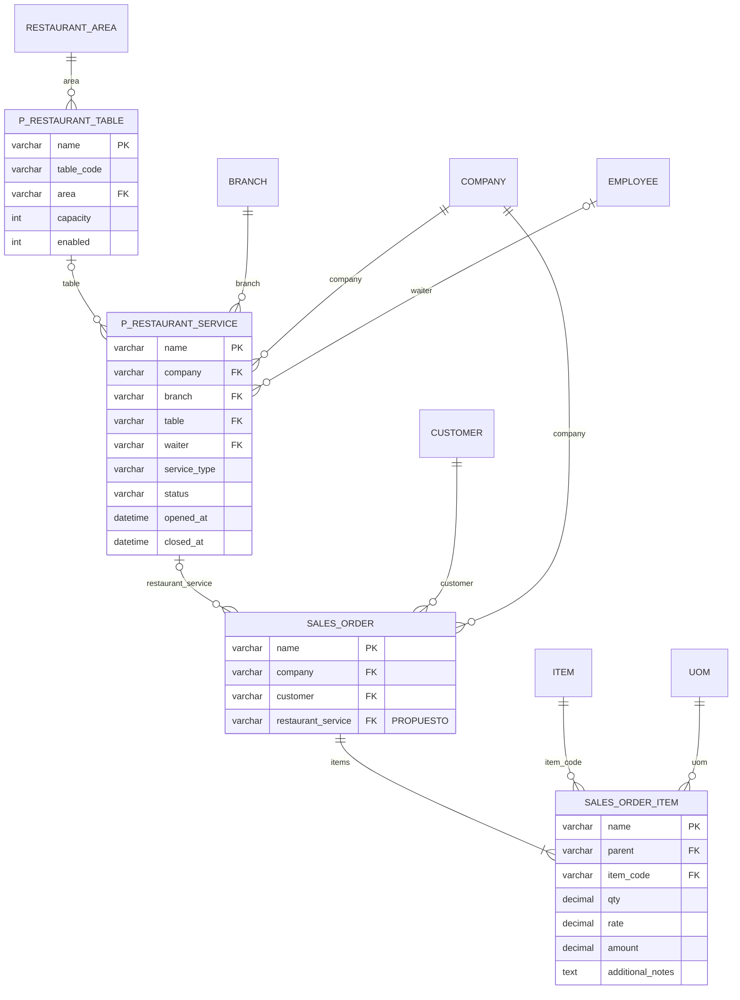
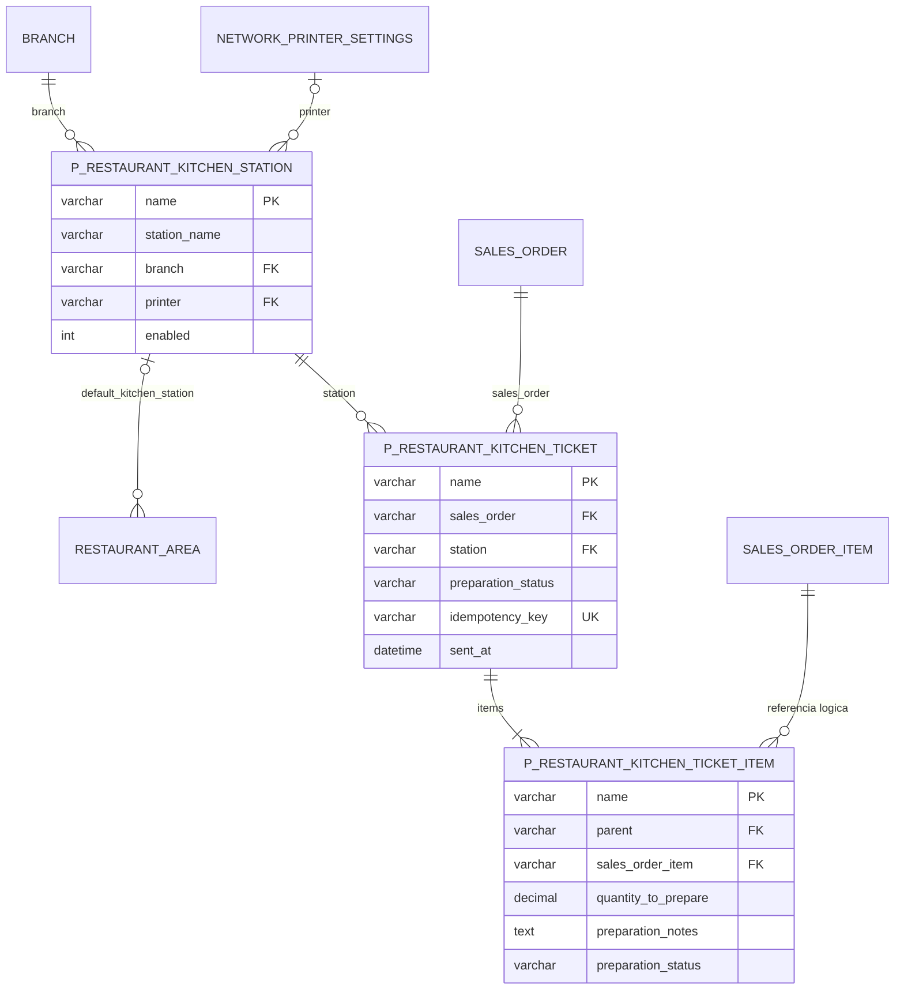
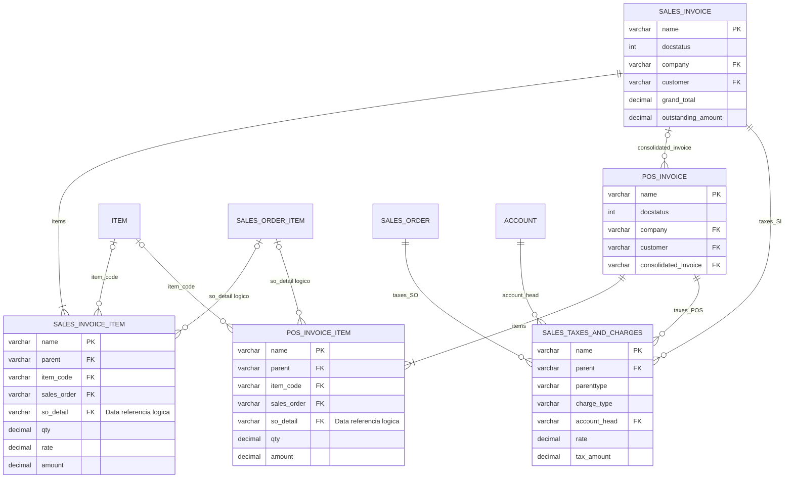
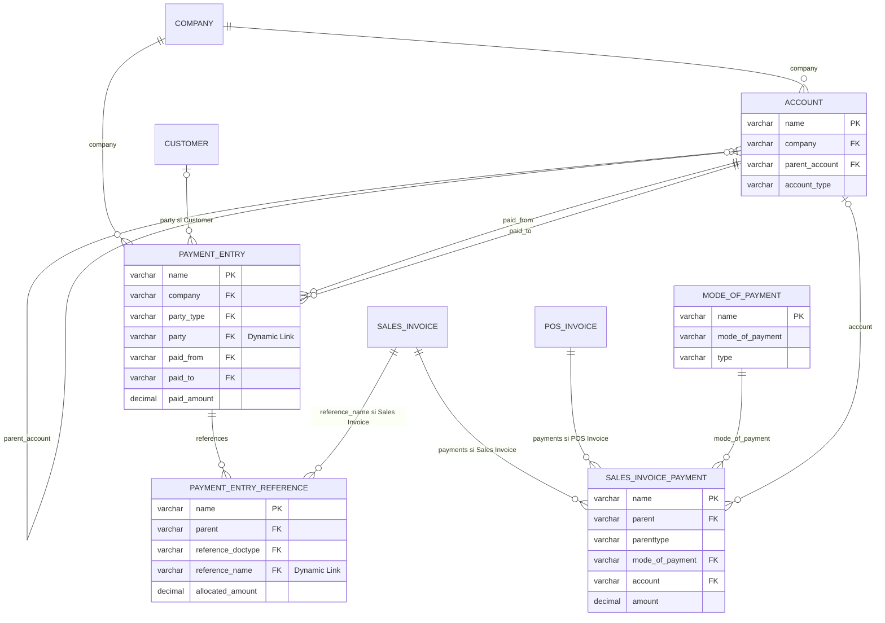
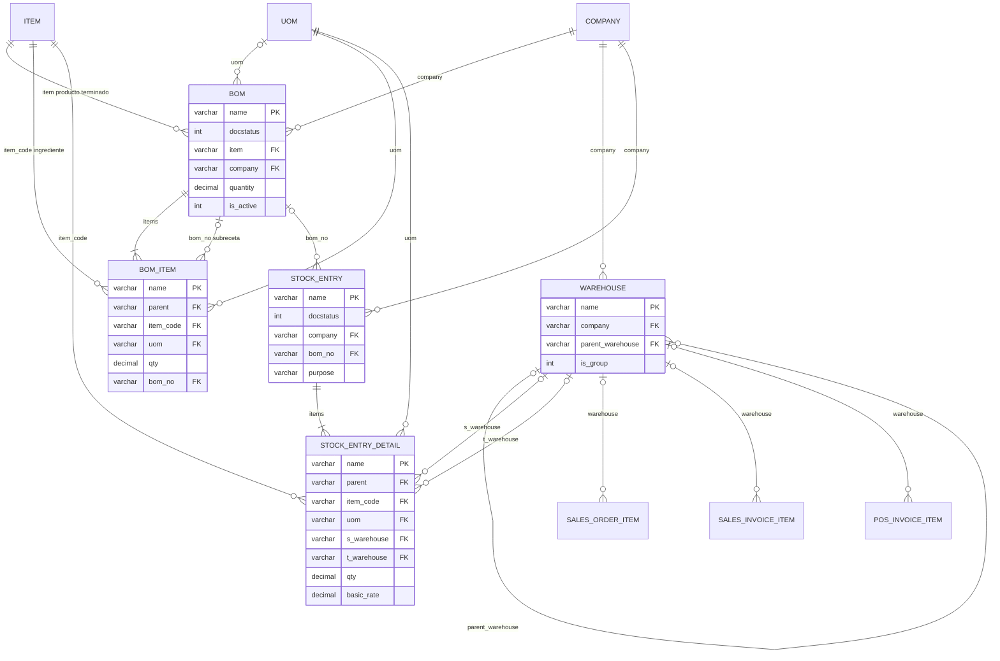

# Modelo de datos — Módulo Restaurante de Leaf ERP

- **Empresa:** Grintsys
- **Proyecto:** Módulo Restaurante para Leaf ERP
- **Responsable académico:** Manuel Padilla — CEUTEC
- **Asignatura:** Proyecto de Graduación Fase 1
- **Actividad:** Módulo 3 — Datos que sostienen el negocio
- **Fecha de corte técnico:** 1 de noviembre de 2026
- **Base inspeccionada:** sitio local `development`; Frappe 14.96.21, ERPNext 14.74.4 y Python 3.11.15.
- **Referencia de código anterior a este documento:** `cdc440bc80130acb126c706299872149e66a2151`, rama `feature/modulo-restaurante`.

## 1. Propósito y alcance

Este documento describe el modelo de datos del producto Restaurante: configuración,
catálogo, atención de mesas, pedidos, cocina, cobro e inventario. Incluye diagramas
entidad–relación en Mermaid, diccionario de los campos relevantes, cardinalidades,
restricciones, comportamiento ante eliminaciones y trazabilidad con las historias.

El modelo reúne **28 entidades nativas disponibles, una entidad propia implementada
y cinco entidades propias propuestas**. Las 34 entidades representan el alcance de
negocio documentado; no significan 34 desarrollos nuevos ni 34 funciones terminadas.
Los catálogos auxiliares generales del ERP se identifican como referencias externas.
No se pretende reproducir todos los campos ni todas las tablas internas de ERPNext.

### 1.1 Estados de evidencia

| Estado | Significado en este documento |
| --- | --- |
| **VERIFIED** | Comprobado mediante lectura de metadatos, esquema SQL o ejecución registrada en el entorno local. |
| **ANALYZED** | Contrastado con código fuente o documentación versionada; no equivale a una prueba integral de negocio. |
| **PROPOSED** | Diseño futuro; requiere validación funcional, implementación, migración y pruebas. |
| **BLOCKED** | Comprobación impedida por una limitación concreta. No se utiliza para presentar propuestas como verificadas. |

**VERIFIED — Estado actual:** existe el DocType independiente `Restaurant Area`,
su formulario nativo, una Page para crear/editar/listar ubicaciones, búsqueda y
paginación en servidor, permisos y datos semilla persistentes. Los enlaces del
Workspace reutilizan catálogos nativos. La ruta de la Page es
`/app/restaurant-location`; su nombre de ruta no cambia el DocType a `Location`.

**ANALYZED — Límite actual:** la app no implementa todavía mesas, sesiones de
atención, pedidos gastronómicos, comandas o KDS. No tiene extensiones activas que
relacionen restaurante con `Sales Order`, `Sales Invoice` o `Stock Entry`.
Las opciones guardadas `visible_in_pos`, `allow_open_accounts` y `printer` son
configuración; por sí solas no activan esas integraciones.

**PROPOSED — Producto completo:** las entidades y enlaces de atención y cocina
permitirían orquestar operaciones nativas. El diseño no acredita un flujo de
restaurante en producción ni un despliegue HTTPS probado.

### 1.2 Índice

1. [Propósito y alcance](#1-propósito-y-alcance)
2. [Decisión arquitectónica y camino nativo](#2-decisión-arquitectónica-y-camino-nativo)
3. [Inventario y trazabilidad](#3-inventario-y-trazabilidad)
4. [Diagramas entidad–relación](#4-diagramas-entidadrelación)
5. [Diccionario de datos](#5-diccionario-de-datos)
6. [Matriz de integridad y reglas](#6-matriz-de-integridad-y-reglas)
7. [Eliminación, cancelación e historial](#7-eliminación-cancelación-e-historial)
8. [Migraciones, semilla y consultas](#8-migraciones-semilla-y-consultas)
9. [Verificación y pendientes de entrega](#9-verificación-y-pendientes-de-entrega)
10. [Fuentes](#10-fuentes)

## 2. Decisión arquitectónica y camino nativo

**Pregunta rectora:** ¿ERPNext ya posee un camino funcional para esta operación?
¿Cómo hacemos que Leaf entre en ese camino en lugar de crear uno propio?

**ANALYZED — Decisión:** Leaf gestiona la operación especializada; ERPNext mantiene
la fuente de verdad de artículos, precios, ventas, impuestos, pagos e inventario.
Se conserva la app independiente `restaurant`, al mismo nivel que las demás apps
del Bench. No se modifica el código de Frappe ni de ERPNext para este documento.

### 2.1 Native Path Check

| Comprobación | Resultado y decisión |
| --- | --- |
| 1. ¿Existe un DocType estándar? | Sí para catálogos, ventas, pagos, recetas y movimientos; reutilizar los identificados abajo. Para áreas se conserva `Restaurant Area` ya implementado por decisión del proyecto. |
| 2. ¿Existe un campo equivalente? | Reutilizar `item_code`, `branch`, `designation`, `warehouse`, etc. No añadir duplicados para cambiar únicamente la etiqueta. |
| 3. ¿Existe un flujo transaccional? | Ventas, facturación, cobros, devoluciones y stock pertenecen al ERP. La selección del flujo de restaurante sigue pendiente de validación. |
| 4. ¿Existe una API nativa? | Usar documentos Frappe y mapeadores nativos; no insertar directamente en libros contables o de inventario. |
| 5. ¿Hay eventos aprovechables? | `validate`, `on_submit` y `on_cancel`; las futuras extensiones se instalarían desde hooks de `restaurant`. |
| 6. ¿Hay controllers reutilizables? | Sí: precios, órdenes, facturas, pagos, BOM y stock poseen controllers. Inspeccionar sus reglas en cada integración. |
| 7. ¿Basta configuración? | Permisos, catálogos, listas de precios y parte de los estados pueden configurarse. No crear tablas por cada estado o etiqueta. |
| 8. ¿Podemos relacionar Leaf con ERPNext? | Sí. Se propone enlazar una sesión de restaurante con órdenes nativas; esa extensión todavía no existe. |
| 9. ¿Puede Leaf orquestar? | Sí. Atención y cocina coordinarían documentos nativos, conservando trazabilidad y reversión. |
| 10. ¿Qué componentes nuevos se justifican? | Áreas ya implementadas; mesas, sesiones y comandas/estaciones como diseño especializado sujeto a validación antes de construirlo. |

### 2.2 Fuentes de verdad

| Información | Fuente de verdad | Nivel y estado |
| --- | --- | --- |
| Área, capacidad y configuración | `Restaurant Area` | Nivel 3 — **VERIFIED**. |
| Producto, categoría, unidad y precio | `Item`, `Item Group`, `UOM`, `Price List`, `Item Price` | Nivel 1 — **VERIFIED**, catálogos y semilla utilizados. |
| Sucursal y personal | `Branch`, `Employee`, `Designation` | Nivel 1 — **VERIFIED** en esquema; personal no poblado por la semilla. |
| Mesa y sesión de atención | `Restaurant Table`, `Restaurant Service` | Nivel 3 — **PROPOSED**. |
| Productos e importes de pedido | `Sales Order` / `Sales Order Item`, como candidato | Nivel 1 más enlace declarativo de nivel 2 — **PROPOSED** para restaurante. |
| Preparación y entrega | Estación, comanda y líneas de cocina propias | Nivel 3 — **PROPOSED**; sin importes fiscales paralelos. |
| Facturación, impuestos, pagos y saldos | `Sales Invoice` o flujo POS; `Payment Entry` cuando corresponda | Nivel 1 — **PROPOSED** la integración; estructuras nativas disponibles. |
| Receta y consumo | `BOM` / `BOM Item`, documentos nativos de stock según proceso validado | Nivel 1 — **PROPOSED** la integración; sin consumo automático actual. |

`Location` nativo no sustituye a `Restaurant Area`. Los Custom Fields heredados
`Location.restaurant_area` y `Location.restaurant_branch` se conservan por
compatibilidad; no son relaciones con el nuevo DocType ni prueban una migración
de ubicaciones antiguas.

## 3. Inventario y trazabilidad

**VERIFIED** identifica disponibilidad física; **ANALYZED** identifica el uso
observado en la app. Que una tabla nativa exista no demuestra que el flujo del
restaurante la utilice de extremo a extremo.

### 3.1 Entidades disponibles

| ID | DocType / tabla física | Función | Uso en Restaurante |
| --- | --- | --- | --- |
| I01 | `Restaurant Area` / `tabRestaurant Area` | Distribución física por sucursal. | Implementado y poblado; HU-02. |
| N01 | `Company` / `tabCompany` | Empresa legal. | Referencia nativa; futura operación de ventas. |
| N02 | `Branch` / `tabBranch` | Sucursal. | Enlace obligatorio de área y semilla; HU-02. |
| N03 | `Employee` / `tabEmployee` | Personal. | Mesero opcional en área; HU-06. |
| N04 | `Designation` / `tabDesignation` | Cargo del empleado. | Cargo Mesero reutilizado; HU-06. |
| N05 | `Network Printer Settings` / `tabNetwork Printer Settings` | Impresora de red. | Enlace opcional en área; impresión no integrada. |
| N06 | `Item Group` / `tabItem Group` | Categorías y subcategorías. | Acceso nativo y semilla; HU-03. |
| N07 | `Item` / `tabItem` | Platos, bebidas e insumos. | Acceso nativo y semilla; HU-04. |
| N08 | `UOM` / `tabUOM` | Unidades de medida. | Catálogo y semilla; HU-04/HU-13. |
| N09 | `Price List` / `tabPrice List` | Lista de precios. | Acceso nativo y semilla; HU-04. |
| N10 | `Item Price` / `tabItem Price` | Precio vigente. | Acceso nativo y semilla; HU-04. |
| N11 | `Customer` / `tabCustomer` | Cliente. | Acceso nativo; integración de consumo pendiente. |
| N12 | `Sales Order` / `tabSales Order` | Orden comercial. | Candidato para HU-07/HU-08/HU-09. |
| N13 | `Sales Order Item` / `tabSales Order Item` | Productos de una orden. | Candidato para HU-08/HU-09. |
| N14 | `Sales Invoice` / `tabSales Invoice` | Factura nativa. | Integración propuesta; HU-11/HU-12. |
| N15 | `Sales Invoice Item` / `tabSales Invoice Item` | Detalle de factura. | Integración propuesta; HU-11/HU-12. |
| N16 | `POS Invoice` / `tabPOS Invoice` | Documento del flujo POS. | Alternativa a evaluar; HU-12. |
| N17 | `POS Invoice Item` / `tabPOS Invoice Item` | Detalle POS. | Alternativa a evaluar; HU-12. |
| N18 | `Sales Taxes and Charges` / `tabSales Taxes and Charges` | Impuestos y cargos. | Reutilización nativa; HU-12. |
| N19 | `Sales Invoice Payment` / `tabSales Invoice Payment` | Pagos de venta POS. | Reutilización condicionada al flujo; HU-12. |
| N20 | `Mode of Payment` / `tabMode of Payment` | Medios de pago. | Catálogo nativo; HU-12. |
| N21 | `Payment Entry` / `tabPayment Entry` | Cobro/pago y asignación. | Cuando el flujo lo requiera; HU-12. |
| N22 | `Payment Entry Reference` / `tabPayment Entry Reference` | Asignación a documentos. | Detalle nativo; HU-12. |
| N23 | `Account` / `tabAccount` | Cuenta contable. | Referencia de impuestos y pagos; HU-12. |
| N24 | `BOM` / `tabBOM` | Receta candidata. | Evaluar adaptación; HU-13. |
| N25 | `BOM Item` / `tabBOM Item` | Ingredientes. | Evaluar adaptación; HU-13. |
| N26 | `Warehouse` / `tabWarehouse` | Almacén. | Operación nativa futura; HU-13. |
| N27 | `Stock Entry` / `tabStock Entry` | Movimiento de stock. | Según proceso validado; HU-13. |
| N28 | `Stock Entry Detail` / `tabStock Entry Detail` | Líneas de movimiento. | Según proceso validado; HU-13. |

### 3.2 Entidades propuestas

Todas las filas siguientes son **PROPOSED**: no existen todavía como DocTypes ni
como tablas de la app. Los nombres son identificadores de diseño sujetos a revisión.

| ID | DocType propuesto | Función | Historias |
| --- | --- | --- | --- |
| P01 | `Restaurant Table` | Mesa física vinculada a un área. | HU-05. |
| P02 | `Restaurant Service` | Sesión de atención o cuenta operativa, sin contabilidad paralela. | HU-07/HU-08/HU-11/HU-12. |
| P03 | `Restaurant Kitchen Station` | Destino operativo de preparación. | HU-09/HU-10. |
| P04 | `Restaurant Kitchen Ticket` | Envío de una orden a una estación. | HU-09/HU-10. |
| P05 | `Restaurant Kitchen Ticket Item` | Cantidad y preparación de una línea original. | HU-09/HU-10. |

HU-01 se resuelve mediante Workspace/Page; HU-14 consulta operaciones nativas y
las relaciones propuestas. No se crea una tabla de reportes para duplicar ventas.
Reservas, asignaciones complejas, división de cuenta y múltiples mesas por sesión
requieren historias y reglas adicionales antes de incorporarse al esquema.

## 4. Diagramas entidad–relación

Los siete diagramas siguientes forman un único modelo por dominios; los nombres
repetidos representan la misma entidad. Se separan para mantener su legibilidad.

- `||`: exactamente uno; `o|`: cero o uno; `o{`: cero o muchos; `|{`: uno o muchos.
- **PK**: clave primaria SQL. **UK**: unicidad física comprobada en el campo.
- **FK** representa una **referencia lógica** mediante Link, Dynamic Link,
  pertenencia de hijo o validación del controller. No declara una FOREIGN KEY SQL.
- El prefijo **P_** identifica entidades propuestas; todas sus relaciones son
  propuestas. Los atributos marcados PROPUESTO tampoco existen todavía.
- Las cardinalidades expresan documentos válidos por las reglas indicadas;
  no convierten esos mínimos en restricciones del motor SQL.

### 4.1 Organización y áreas — VERIFIED / ANALYZED



No se dibuja `Branch → Company`: el DocType `Branch` inspeccionado no contiene
ese campo. El mesero de un área debe estar activo, tener cargo `Mesero` y
pertenecer a la misma sucursal; se valida en servidor, no mediante una FK SQL.

### 4.2 Catálogo reutilizado — VERIFIED / ANALYZED



`Item Price` materializa la relación N:M entre artículos y listas, con dimensiones
como unidad, vigencia y cliente. No existe un UNIQUE SQL simple
`(item_code, price_list)`; ese índice impediría variantes nativas válidas.
Las demás dimensiones permanecen bajo las reglas del controller nativo.

### 4.3 Atención y pedidos — PROPOSED

Los nodos sin P_ ya existen en ERPNext. Los nodos P_, sus relaciones y el campo
restaurant_service son diseño futuro. Una sesión agrupa varios pedidos; una mesa
puede tener muchas sesiones históricas. El control de una sola sesión abierta
por mesa debe implementarse con concurrencia en servidor.



### 4.4 Cocina y preparación — PROPOSED

La estación, comanda, líneas, UK idempotency_key y default_kitchen_station son
propuestas. Una línea de pedido puede enviarse en varias tandas; la suma enviada
no debe exceder su cantidad autorizada. Cada tanda conserva la referencia a la
fila original. Las observaciones del pedido pueden reutilizar el campo nativo
Sales Order Item.additional_notes, sin añadir un campo duplicado.



### 4.5 Facturación e impuestos — ANALYZED; integración PROPOSED

Se muestran las relaciones de detalle. Las dos cabeceras de factura también
referencian Company y Customer; sales_order en cada detalle referencia Sales
Order, según el diccionario. customer no tiene reqd en los JSON de ambas facturas;
los controllers y la configuración pueden exigirlo según la operación.



En el diagrama, taxes_SO, taxes_SI y taxes_POS identifican el campo taxes según
el DocType propietario. Una fila pertenece a **uno** de los documentos indicados
por parenttype, parent y parentfield. Las aristas condicionales son alternativas,
no tres propietarios simultáneos. so_detail es Data y no un Link nativo.

### 4.6 Cobros y asignaciones — ANALYZED; integración PROPOSED



Las filas de pagos también tienen un único padre según parenttype. Payment Entry
Reference puede apuntar a distintos DocTypes; la arista a factura aplica solo si
reference_doctype = Sales Invoice. party depende de party_type.

No se obliga a emitir Sales Invoice, POS Invoice y Payment Entry para cada
consumo. El flujo elegido debe evitar duplicar venta, pago y contabilización;
la consolidación POS permanece bajo control del proceso nativo.

### 4.7 Recetas y movimientos — ANALYZED; integración PROPOSED



BOM y sus ingredientes resuelven otra relación N:M: un producto puede tener
recetas y un ingrediente participar en varias. Los movimientos pertenecen a
documentos nativos de stock. restaurant no automatiza consumo por venta.
Preparación previa, fabricación y consumo requieren análisis funcional; no se
propone otra tabla de existencias ni una arista automática factura–stock.

## 5. Diccionario de datos

### 5.1 Convenciones físicas y campos comunes — VERIFIED

Las tablas inspeccionadas utilizan MariaDB e InnoDB. El DocType `Restaurant Area`
corresponde a `tabRestaurant Area`. Un campo `Table` guarda sus filas en otro
DocType; no es una columna JSON ni una lista separada por comas.

| Campo común | Tipo SQL observado | Función y restricción |
| --- | --- | --- |
| `name` | `varchar(140) NOT NULL` | PK de cada registro, incluidos los hijos. Un Link apunta a name, aunque el campo se llame item_code. |
| `creation`, `modified` | `datetime(6)`, admite NULL | Auditoría mantenida por Frappe. modified participa en el control de concurrencia del guardado del área. |
| `owner`, `modified_by` | `varchar(140)`, admite NULL | Identificadores de usuario mantenidos por Frappe; no son FK SQL declaradas. |
| `docstatus` | `int(1) NOT NULL DEFAULT 0` | 0 borrador, 1 enviado, 2 cancelado, cuando el DocType soporta ese ciclo. El área no es submittable. |
| `idx` | `int(8) NOT NULL DEFAULT 0` | Posición de una fila hija; no es su PK. |
| `parent` | `varchar(140)`, admite NULL | Solo en hijos: identificador del propietario; índice nativo, sin FK SQL. |
| `parenttype` | `varchar(140)`, admite NULL | DocType del propietario. Necesario cuando una tabla hija se reutiliza. |
| `parentfield` | `varchar(140)`, admite NULL | Campo Table del propietario al que pertenece la fila. |

Los campos auxiliares de comentarios, asignaciones y etiquetas no forman parte
del modelo de negocio ni se utilizan como relaciones de la app.

**Tipos numéricos:** `Currency`, `Float` y `Percent` de los campos inspeccionados
se almacenan como `DECIMAL(21,9)`, con `NOT NULL DEFAULT 0`. No se asume FLOAT
binario ni `DECIMAL(10,2)` para dinero. La precisión visible, el redondeo y la
conversión de moneda pertenecen a las reglas nativas. Las cantidades respetan UOM
enteras o fraccionarias. Las devoluciones tienen reglas propias y no deben
bloquearse con un CHECK genérico de cantidades positivas.

**Fechas y zona horaria:** la zona verificada del sitio es `America/Tegucigalpa`.
Los Datetime se guardan sin zona en `datetime(6)`; `now_datetime()` entrega la
hora del sistema sin tzinfo. No se afirma que los timestamps actuales se guarden
en UTC. Las futuras APIs deben explicitar zona/offset al intercambiar fechas y
usar las utilidades del framework.

### 5.2 I01 — Restaurant Area: diccionario completo de negocio — VERIFIED

Fuente de esquema: [restaurant_area.json](../restaurant/restaurant/doctype/restaurant_area/restaurant_area.json).
Fuente de reglas: [location.py](../restaurant/location.py), invocada por el
[controller](../restaurant/restaurant/doctype/restaurant_area/restaurant_area.py).
Los dos Section Break del formulario no crean columnas.

**ANALYZED — Actualización del 4 de noviembre de 2026:** el formulario se denomina
Áreas y utiliza Nombre del área. Se retira area_type de los metadatos activos
y las validaciones; su columna histórica se conserva sin reescribir registros.

`name` se genera inicialmente desde `area_name` (`autoname = field:area_name`).
La unicidad de `area_name` es **global**, no por sucursal. Cambiar un texto visible
no debe tratarse como actualización manual de PK; para renombrar se requiere el
proceso nativo de Frappe. `allow_rename = 1` está habilitado.

| Campo | Tipo Frappe / SQL | Obligatorio | Regla, default y referencia |
| --- | --- | --- | --- |
| `area_name` | Data / `varchar(140)` NULL; **UNIQUE** | Sí, servidor | Nombre sin espacios extremos, no vacío, hasta 140 caracteres; origina name. |
| `branch` | Link / `varchar(140)` NULL | Sí, servidor | Branch.name; existencia y permiso de lectura/selección. Sin FK SQL. |
| `display_order` | Int / `int(11) NOT NULL` | Valor válido | Entero 0–2147483647; default 0. |
| `capacity` | Int / `int(11) NOT NULL` | Sí, servidor | Entero 1–2147483647. SQL default 0 no cumple la regla de negocio. |
| `status` | Select / `varchar(140)` NULL | Sí, servidor | Activa o Inactiva; default Activa. |
| `visible_in_pos` | Check / `int(1) NOT NULL` | Valor válido | 0 o 1; default 1. Preferencia guardada, integración POS pendiente. |
| `description` | Small Text / `text` NULL | No | Hasta 500 caracteres en servidor. |
| `image` | Attach Image / `text` NULL | No | URL local de un File existente y autorizado; no es Link ni FK SQL. JPG/JPEG, PNG, GIF, WEBP o AVIF; se rechazan rutas externas o inválidas. |
| `icon` | Select / `varchar(140)` NULL | Sí, servidor | Terraza, Salón, Barra, Jardín; default Terraza. |
| `printer` | Link / `varchar(140)` NULL | No | Network Printer Settings.name; debe existir y ser accesible. No envía impresiones por sí mismo. |
| `waiter` | Link / `varchar(140)` NULL | No | Employee.name; activo, cargo exacto Mesero, misma sucursal y permiso requerido. |
| `allow_open_accounts` | Check / `int(1) NOT NULL` | Valor válido | 0 o 1; default 1. Apertura de cuentas aún no implementada. |
| `color` | Color / `varchar(140)` NULL | Valor válido | Formato hexadecimal #RRGGBB; default #22C55E. |
| `notes` | Small Text / `text` NULL | No | Hasta 300 caracteres en servidor. |

El esquema dispone de PK name, UNIQUE area_name e índice modified.
No tiene FK SQL ni CHECK SQL. El guardado nativo y la API ejecutan la misma
validación; la interfaz no es la única barrera de integridad.

### 5.3 Diccionario de integración nativa — VERIFIED / ANALYZED

Se documentan los **campos de negocio que intervienen en este modelo**, además
de los campos comunes. No reemplazan el diccionario íntegro del ERP ni autorizan
a omitir otros campos que exija su controller al crear documentos.

**Lectura:** `Req.` significa reqd en los metadatos de Frappe, no SQL NOT NULL.
`NN` significa NOT NULL físico; `NULL`, que el motor admite nulos. `Table` indica
una colección en el DocType hijo. Los Links son referencias lógicas sin FK SQL
en las tablas inspeccionadas. Un No en Req. no garantiza que el campo sea opcional
en todos los flujos nativos.

Catálogos generales como `Currency`, `Country`, `Customer Group`, `Territory`,
`DocType` y `Stock Entry Type` siguen siendo referencias externas al alcance
especializado; se reutilizan sin duplicarlos ni contarlos como desarrollo nuevo.

#### N01 — Company

Empresa legal y moneda predeterminada. No se deduce la empresa desde Branch porque ese enlace no existe.

| Campo | Tipo Frappe / SQL físico | Req. | Referencia o condición |
| --- | --- | --- | --- |
| `company_name` | Data / `varchar(140)` NULL | Sí | Dato nativo; reglas adicionales en controller. UNIQUE SQL. |
| `abbr` | Data / `varchar(140)` NULL | Sí | Dato nativo; reglas adicionales en controller. |
| `default_currency` | Link / `varchar(140)` NULL | Sí | Link → Currency |

#### N02 — Branch

Sucursal del área y del empleado. branch es texto; los enlaces entrantes apuntan a la PK name.

| Campo | Tipo Frappe / SQL físico | Req. | Referencia o condición |
| --- | --- | --- | --- |
| `branch` | Data / `varchar(140)` NULL | Sí | Dato nativo; reglas adicionales en controller. |

#### N03 — Employee

Personal existente. El área reutiliza al empleado como mesero predeterminado.

| Campo | Tipo Frappe / SQL físico | Req. | Referencia o condición |
| --- | --- | --- | --- |
| `employee_name` | Data / `varchar(140)` NULL | No | Dato nativo; reglas adicionales en controller. |
| `company` | Link / `varchar(140)` NULL | Sí | Link → Company |
| `branch` | Link / `varchar(140)` NULL | No | Link → Branch |
| `designation` | Link / `varchar(140)` NULL | No | Link → Designation |
| `status` | Select / `varchar(140)` NULL | Sí | Opciones nativas; validar con controller. |

#### N04 — Designation

Cargo del empleado. El valor Mesero se compara en servidor; no requiere duplicar empleados.

| Campo | Tipo Frappe / SQL físico | Req. | Referencia o condición |
| --- | --- | --- | --- |
| `designation_name` | Data / `varchar(140)` NULL | Sí | Dato nativo; reglas adicionales en controller. UNIQUE SQL. |

#### N05 — Network Printer Settings

Configuración de impresora. printer_name es Select, no una relación con otro DocType.

| Campo | Tipo Frappe / SQL físico | Req. | Referencia o condición |
| --- | --- | --- | --- |
| `printer_name` | Select / `varchar(140)` NULL | Sí | Opciones nativas; validar con controller. |
| `server_ip` | Data / `varchar(140)` NULL | Sí | Dato nativo; reglas adicionales en controller. |
| `port` | Int / `int(11)` NN | Sí | Dato nativo; reglas adicionales en controller. |

#### N06 — Item Group

Árbol de categorías. El ERP mantiene sus índices jerárquicos.

| Campo | Tipo Frappe / SQL físico | Req. | Referencia o condición |
| --- | --- | --- | --- |
| `item_group_name` | Data / `varchar(140)` NULL | Sí | Dato nativo; reglas adicionales en controller. UNIQUE SQL. |
| `parent_item_group` | Link / `varchar(140)` NULL | No | Link → Item Group |
| `is_group` | Check / `int(1)` NN | No | Indicador nativo 0/1. |

#### N07 — Item

Catálogo único de platos, bebidas e insumos. item_code es Data único; los Links a Item usan name.

| Campo | Tipo Frappe / SQL físico | Req. | Referencia o condición |
| --- | --- | --- | --- |
| `item_code` | Data / `varchar(140)` NULL | Sí | Dato nativo; reglas adicionales en controller. UNIQUE SQL. |
| `item_name` | Data / `varchar(140)` NULL | No | Dato nativo; reglas adicionales en controller. |
| `item_group` | Link / `varchar(140)` NULL | Sí | Link → Item Group |
| `stock_uom` | Link / `varchar(140)` NULL | Sí | Link → UOM |
| `is_stock_item` | Check / `int(1)` NN | No | Indicador nativo 0/1. |
| `disabled` | Check / `int(1)` NN | No | Indicador nativo 0/1. |

#### N08 — UOM

Unidades enteras o fraccionarias. Respetar must_be_whole_number y conversiones nativas.

| Campo | Tipo Frappe / SQL físico | Req. | Referencia o condición |
| --- | --- | --- | --- |
| `uom_name` | Data / `varchar(140)` NULL | Sí | Dato nativo; reglas adicionales en controller. UNIQUE SQL. |
| `must_be_whole_number` | Check / `int(1)` NN | No | Indicador nativo 0/1. |
| `enabled` | Check / `int(1)` NN | No | Indicador nativo 0/1. |

#### N09 — Price List

Agrupa precios por moneda y propósito de venta/compra.

| Campo | Tipo Frappe / SQL físico | Req. | Referencia o condición |
| --- | --- | --- | --- |
| `price_list_name` | Data / `varchar(140)` NULL | Sí | Dato nativo; reglas adicionales en controller. UNIQUE SQL. |
| `currency` | Link / `varchar(140)` NULL | Sí | Link → Currency |
| `selling` | Check / `int(1)` NN | No | Indicador nativo 0/1. |
| `buying` | Check / `int(1)` NN | No | Indicador nativo 0/1. |
| `enabled` | Check / `int(1)` NN | No | Indicador nativo 0/1. |

#### N10 — Item Price

Precio de catálogo por artículo, lista y dimensiones adicionales. El controller valida vigencias y duplicados; no hay UNIQUE SQL simple de artículo más lista.

| Campo | Tipo Frappe / SQL físico | Req. | Referencia o condición |
| --- | --- | --- | --- |
| `item_code` | Link / `varchar(140)` NULL | Sí | Link → Item |
| `price_list` | Link / `varchar(140)` NULL | Sí | Link → Price List |
| `uom` | Link / `varchar(140)` NULL | No | Link → UOM |
| `currency` | Link / `varchar(140)` NULL | No | Link → Currency |
| `price_list_rate` | Currency / `decimal(21,9)` NN | Sí | Precisión/cálculo nativos; SQL default 0. |
| `valid_from` | Date / `date` NULL | No | Dato nativo; reglas adicionales en controller. |
| `valid_upto` | Date / `date` NULL | No | Dato nativo; reglas adicionales en controller. |
| `customer` | Link / `varchar(140)` NULL | No | Link → Customer |

#### N11 — Customer

Cliente comercial. Grupos y territorios se reutilizan del ERP.

| Campo | Tipo Frappe / SQL físico | Req. | Referencia o condición |
| --- | --- | --- | --- |
| `customer_name` | Data / `varchar(140)` NULL | Sí | Dato nativo; reglas adicionales en controller. |
| `customer_type` | Select / `varchar(140)` NULL | Sí | Opciones nativas; validar con controller. |
| `customer_group` | Link / `varchar(140)` NULL | Sí | Link → Customer Group |
| `territory` | Link / `varchar(140)` NULL | Sí | Link → Territory |
| `disabled` | Check / `int(1)` NN | No | Indicador nativo 0/1. |

#### N12 — Sales Order

Candidato para pedidos. El enlace a Restaurant Service todavía no está instalado.

| Campo | Tipo Frappe / SQL físico | Req. | Referencia o condición |
| --- | --- | --- | --- |
| `company` | Link / `varchar(140)` NULL | Sí | Link → Company |
| `customer` | Link / `varchar(140)` NULL | Sí | Link → Customer |
| `transaction_date` | Date / `date` NULL | Sí | Dato nativo; reglas adicionales en controller. |
| `delivery_date` | Date / `date` NULL | No | Dato nativo; reglas adicionales en controller. |
| `currency` | Link / `varchar(140)` NULL | Sí | Link → Currency |
| `selling_price_list` | Link / `varchar(140)` NULL | Sí | Link → Price List |
| `items` | Table / sin columna; tabla hija | Sí | Filas → Sales Order Item |
| `taxes` | Table / sin columna; tabla hija | No | Filas → Sales Taxes and Charges |
| `grand_total` | Currency / `decimal(21,9)` NN | No | Precisión/cálculo nativos; SQL default 0. |
| `status` | Select / `varchar(140)` NULL | Sí | Opciones nativas; validar con controller. |

#### N13 — Sales Order Item

Detalle de orden. Los precios transaccionales conservan el historial; no se sustituyen por el precio de catálogo actual.

**Tabla hija:** incluye PK propia y campos de pertenencia de §5.1.

| Campo | Tipo Frappe / SQL físico | Req. | Referencia o condición |
| --- | --- | --- | --- |
| `item_code` | Link / `varchar(140)` NULL | Sí | Link → Item |
| `item_name` | Data / `varchar(140)` NULL | Sí | Dato nativo; reglas adicionales en controller. |
| `qty` | Float / `decimal(21,9)` NN | Sí | Precisión/cálculo nativos; SQL default 0. |
| `uom` | Link / `varchar(140)` NULL | Sí | Link → UOM |
| `stock_uom` | Link / `varchar(140)` NULL | No | Link → UOM |
| `conversion_factor` | Float / `decimal(21,9)` NN | Sí | Precisión/cálculo nativos; SQL default 0. |
| `rate` | Currency / `decimal(21,9)` NN | No | Precisión/cálculo nativos; SQL default 0. |
| `amount` | Currency / `decimal(21,9)` NN | No | Precisión/cálculo nativos; SQL default 0. |
| `warehouse` | Link / `varchar(140)` NULL | No | Link → Warehouse |
| `bom_no` | Link / `varchar(140)` NULL | No | Link → BOM |

#### N14 — Sales Invoice

Factura nativa y autoridad de sus importes/saldo. Integración de restaurante propuesta.

| Campo | Tipo Frappe / SQL físico | Req. | Referencia o condición |
| --- | --- | --- | --- |
| `company` | Link / `varchar(140)` NULL | Sí | Link → Company |
| `customer` | Link / `varchar(140)` NULL | No | Link → Customer |
| `posting_date` | Date / `date` NULL | Sí | Dato nativo; reglas adicionales en controller. |
| `posting_time` | Time / `time(6)` NULL | No | Dato nativo; reglas adicionales en controller. |
| `currency` | Link / `varchar(140)` NULL | Sí | Link → Currency |
| `items` | Table / sin columna; tabla hija | Sí | Filas → Sales Invoice Item |
| `taxes` | Table / sin columna; tabla hija | No | Filas → Sales Taxes and Charges |
| `payments` | Table / sin columna; tabla hija | No | Filas → Sales Invoice Payment |
| `grand_total` | Currency / `decimal(21,9)` NN | Sí | Precisión/cálculo nativos; SQL default 0. |
| `outstanding_amount` | Currency / `decimal(21,9)` NN | No | Precisión/cálculo nativos; SQL default 0. |
| `update_stock` | Check / `int(1)` NN | No | Indicador nativo 0/1. |
| `is_pos` | Check / `int(1)` NN | No | Indicador nativo 0/1. |

#### N15 — Sales Invoice Item

Detalle de factura. so_detail es Data, referencia lógica a una fila de orden, no Link.

**Tabla hija:** incluye PK propia y campos de pertenencia de §5.1.

| Campo | Tipo Frappe / SQL físico | Req. | Referencia o condición |
| --- | --- | --- | --- |
| `item_code` | Link / `varchar(140)` NULL | No | Link → Item |
| `qty` | Float / `decimal(21,9)` NN | No | Precisión/cálculo nativos; SQL default 0. |
| `uom` | Link / `varchar(140)` NULL | Sí | Link → UOM |
| `rate` | Currency / `decimal(21,9)` NN | Sí | Precisión/cálculo nativos; SQL default 0. |
| `amount` | Currency / `decimal(21,9)` NN | Sí | Precisión/cálculo nativos; SQL default 0. |
| `warehouse` | Link / `varchar(140)` NULL | No | Link → Warehouse |
| `sales_order` | Link / `varchar(140)` NULL | No | Link → Sales Order |
| `so_detail` | Data / `varchar(140)` NULL | No | Data → Sales Order Item.name; referencia lógica, no Link. |

#### N16 — POS Invoice

Alternativa del flujo POS. consolidated_invoice conserva la relación nativa con la factura de consolidación cuando corresponde.

| Campo | Tipo Frappe / SQL físico | Req. | Referencia o condición |
| --- | --- | --- | --- |
| `company` | Link / `varchar(140)` NULL | Sí | Link → Company |
| `customer` | Link / `varchar(140)` NULL | No | Link → Customer |
| `posting_date` | Date / `date` NULL | Sí | Dato nativo; reglas adicionales en controller. |
| `posting_time` | Time / `time(6)` NULL | No | Dato nativo; reglas adicionales en controller. |
| `currency` | Link / `varchar(140)` NULL | Sí | Link → Currency |
| `items` | Table / sin columna; tabla hija | Sí | Filas → POS Invoice Item |
| `taxes` | Table / sin columna; tabla hija | No | Filas → Sales Taxes and Charges |
| `payments` | Table / sin columna; tabla hija | No | Filas → Sales Invoice Payment |
| `grand_total` | Currency / `decimal(21,9)` NN | Sí | Precisión/cálculo nativos; SQL default 0. |
| `outstanding_amount` | Currency / `decimal(21,9)` NN | No | Precisión/cálculo nativos; SQL default 0. |
| `consolidated_invoice` | Link / `varchar(140)` NULL | No | Link → Sales Invoice |

#### N17 — POS Invoice Item

Detalle POS. so_detail también es Data. No duplicar la venta con otro documento creado por la app.

**Tabla hija:** incluye PK propia y campos de pertenencia de §5.1.

| Campo | Tipo Frappe / SQL físico | Req. | Referencia o condición |
| --- | --- | --- | --- |
| `item_code` | Link / `varchar(140)` NULL | No | Link → Item |
| `qty` | Float / `decimal(21,9)` NN | No | Precisión/cálculo nativos; SQL default 0. |
| `uom` | Link / `varchar(140)` NULL | Sí | Link → UOM |
| `rate` | Currency / `decimal(21,9)` NN | Sí | Precisión/cálculo nativos; SQL default 0. |
| `amount` | Currency / `decimal(21,9)` NN | Sí | Precisión/cálculo nativos; SQL default 0. |
| `warehouse` | Link / `varchar(140)` NULL | No | Link → Warehouse |
| `sales_order` | Link / `varchar(140)` NULL | No | Link → Sales Order |
| `so_detail` | Data / `varchar(140)` NULL | No | Data → Sales Order Item.name; referencia lógica, no Link. |

#### N18 — Sales Taxes and Charges

Hijo compartido por documentos de venta. parenttype identifica un solo propietario por fila.

**Tabla hija:** incluye PK propia y campos de pertenencia de §5.1.

| Campo | Tipo Frappe / SQL físico | Req. | Referencia o condición |
| --- | --- | --- | --- |
| `charge_type` | Select / `varchar(140)` NULL | Sí | Opciones nativas; validar con controller. |
| `account_head` | Link / `varchar(140)` NULL | Sí | Link → Account |
| `rate` | Float / `decimal(21,9)` NN | No | Precisión/cálculo nativos; SQL default 0. |
| `tax_amount` | Currency / `decimal(21,9)` NN | No | Precisión/cálculo nativos; SQL default 0. |
| `total` | Currency / `decimal(21,9)` NN | No | Precisión/cálculo nativos; SQL default 0. |

#### N19 — Sales Invoice Payment

Hijo de pagos usado por Sales Invoice y POS Invoice. La pertenencia utiliza parenttype, parent y parentfield.

**Tabla hija:** incluye PK propia y campos de pertenencia de §5.1.

| Campo | Tipo Frappe / SQL físico | Req. | Referencia o condición |
| --- | --- | --- | --- |
| `mode_of_payment` | Link / `varchar(140)` NULL | Sí | Link → Mode of Payment |
| `account` | Link / `varchar(140)` NULL | No | Link → Account |
| `amount` | Currency / `decimal(21,9)` NN | Sí | Precisión/cálculo nativos; SQL default 0. |
| `base_amount` | Currency / `decimal(21,9)` NN | No | Precisión/cálculo nativos; SQL default 0. |

#### N20 — Mode of Payment

Catálogo de medios de pago. No equivale a un cobro efectuado.

| Campo | Tipo Frappe / SQL físico | Req. | Referencia o condición |
| --- | --- | --- | --- |
| `mode_of_payment` | Data / `varchar(140)` NULL | Sí | Dato nativo; reglas adicionales en controller. UNIQUE SQL. |
| `type` | Select / `varchar(140)` NULL | No | Opciones nativas; validar con controller. |
| `enabled` | Check / `int(1)` NN | No | Indicador nativo 0/1. |

#### N21 — Payment Entry

Documento de cobro/pago. party es Dynamic Link dirigido por party_type; no siempre referencia a Customer.

| Campo | Tipo Frappe / SQL físico | Req. | Referencia o condición |
| --- | --- | --- | --- |
| `payment_type` | Select / `varchar(140)` NULL | Sí | Opciones nativas; validar con controller. |
| `company` | Link / `varchar(140)` NULL | Sí | Link → Company |
| `posting_date` | Date / `date` NULL | Sí | Dato nativo; reglas adicionales en controller. |
| `party_type` | Link / `varchar(140)` NULL | No | Link → DocType |
| `party` | Dynamic Link / `varchar(140)` NULL | No | Dynamic Link según party_type |
| `paid_from` | Link / `varchar(140)` NULL | Sí | Link → Account |
| `paid_to` | Link / `varchar(140)` NULL | Sí | Link → Account |
| `paid_amount` | Currency / `decimal(21,9)` NN | Sí | Precisión/cálculo nativos; SQL default 0. |
| `received_amount` | Currency / `decimal(21,9)` NN | Sí | Precisión/cálculo nativos; SQL default 0. |
| `references` | Table / sin columna; tabla hija | No | Filas → Payment Entry Reference |

#### N22 — Payment Entry Reference

Hijo de asignaciones. reference_name es Dynamic Link; factura es un destino posible. Sus importes son Float Frappe y DECIMAL físico.

**Tabla hija:** incluye PK propia y campos de pertenencia de §5.1.

| Campo | Tipo Frappe / SQL físico | Req. | Referencia o condición |
| --- | --- | --- | --- |
| `reference_doctype` | Link / `varchar(140)` NULL | Sí | Link → DocType |
| `reference_name` | Dynamic Link / `varchar(140)` NULL | Sí | Dynamic Link según reference_doctype |
| `total_amount` | Float / `decimal(21,9)` NN | No | Precisión/cálculo nativos; SQL default 0. |
| `outstanding_amount` | Float / `decimal(21,9)` NN | No | Precisión/cálculo nativos; SQL default 0. |
| `allocated_amount` | Float / `decimal(21,9)` NN | No | Precisión/cálculo nativos; SQL default 0. |

#### N23 — Account

Plan contable nativo. Movimientos y saldos pertenecen al motor ERPNext. parent_account tiene reqd en metadatos; las cuentas raíz creadas por el proceso interno pueden no tener padre. La cardinalidad opcional del diagrama contempla esa excepción nativa.

| Campo | Tipo Frappe / SQL físico | Req. | Referencia o condición |
| --- | --- | --- | --- |
| `account_name` | Data / `varchar(140)` NULL | Sí | Dato nativo; reglas adicionales en controller. |
| `company` | Link / `varchar(140)` NULL | Sí | Link → Company |
| `parent_account` | Link / `varchar(140)` NULL | Sí | Link → Account |
| `is_group` | Check / `int(1)` NN | No | Indicador nativo 0/1. |
| `account_type` | Select / `varchar(140)` NULL | No | Opciones nativas; validar con controller. |
| `account_currency` | Link / `varchar(140)` NULL | No | Link → Currency |

#### N24 — BOM

Candidato para recetas. Validar el flujo gastronómico antes de automatizar fabricación o consumo.

| Campo | Tipo Frappe / SQL físico | Req. | Referencia o condición |
| --- | --- | --- | --- |
| `item` | Link / `varchar(140)` NULL | Sí | Link → Item |
| `company` | Link / `varchar(140)` NULL | Sí | Link → Company |
| `quantity` | Float / `decimal(21,9)` NN | Sí | Precisión/cálculo nativos; SQL default 0. |
| `uom` | Link / `varchar(140)` NULL | No | Link → UOM |
| `is_active` | Check / `int(1)` NN | No | Indicador nativo 0/1. |
| `is_default` | Check / `int(1)` NN | No | Indicador nativo 0/1. |
| `items` | Table / sin columna; tabla hija | Sí | Filas → BOM Item |

#### N25 — BOM Item

Ingredientes; bom_no permite subrecetas según reglas nativas.

**Tabla hija:** incluye PK propia y campos de pertenencia de §5.1.

| Campo | Tipo Frappe / SQL físico | Req. | Referencia o condición |
| --- | --- | --- | --- |
| `item_code` | Link / `varchar(140)` NULL | Sí | Link → Item |
| `qty` | Float / `decimal(21,9)` NN | Sí | Precisión/cálculo nativos; SQL default 0. |
| `uom` | Link / `varchar(140)` NULL | Sí | Link → UOM |
| `stock_uom` | Link / `varchar(140)` NULL | No | Link → UOM |
| `bom_no` | Link / `varchar(140)` NULL | No | Link → BOM |

#### N26 — Warehouse

Almacén por empresa y árbol de almacenes. Se utiliza stock del ERP.

| Campo | Tipo Frappe / SQL físico | Req. | Referencia o condición |
| --- | --- | --- | --- |
| `warehouse_name` | Data / `varchar(140)` NULL | Sí | Dato nativo; reglas adicionales en controller. |
| `company` | Link / `varchar(140)` NULL | Sí | Link → Company |
| `parent_warehouse` | Link / `varchar(140)` NULL | No | Link → Warehouse |
| `is_group` | Check / `int(1)` NN | No | Indicador nativo 0/1. |
| `disabled` | Check / `int(1)` NN | No | Indicador nativo 0/1. |

#### N27 — Stock Entry

Movimiento nativo. purpose y tipo determinan las reglas; restaurant no lo genera automáticamente por venta.

| Campo | Tipo Frappe / SQL físico | Req. | Referencia o condición |
| --- | --- | --- | --- |
| `company` | Link / `varchar(140)` NULL | Sí | Link → Company |
| `stock_entry_type` | Link / `varchar(140)` NULL | Sí | Link → Stock Entry Type |
| `purpose` | Select / `varchar(140)` NULL | No | Opciones nativas; validar con controller. |
| `posting_date` | Date / `date` NULL | No | Dato nativo; reglas adicionales en controller. |
| `posting_time` | Time / `time(6)` NULL | No | Dato nativo; reglas adicionales en controller. |
| `bom_no` | Link / `varchar(140)` NULL | No | Link → BOM |
| `items` | Table / sin columna; tabla hija | Sí | Filas → Stock Entry Detail |

#### N28 — Stock Entry Detail

Línea de movimiento. Origen/destino de almacén son condicionales; no exigir ambos para toda operación.

**Tabla hija:** incluye PK propia y campos de pertenencia de §5.1.

| Campo | Tipo Frappe / SQL físico | Req. | Referencia o condición |
| --- | --- | --- | --- |
| `item_code` | Link / `varchar(140)` NULL | Sí | Link → Item |
| `qty` | Float / `decimal(21,9)` NN | Sí | Precisión/cálculo nativos; SQL default 0. |
| `uom` | Link / `varchar(140)` NULL | Sí | Link → UOM |
| `stock_uom` | Link / `varchar(140)` NULL | Sí | Link → UOM |
| `conversion_factor` | Float / `decimal(21,9)` NN | Sí | Precisión/cálculo nativos; SQL default 0. |
| `s_warehouse` | Link / `varchar(140)` NULL | No | Link → Warehouse |
| `t_warehouse` | Link / `varchar(140)` NULL | No | Link → Warehouse |
| `basic_rate` | Currency / `decimal(21,9)` NN | No | Precisión/cálculo nativos; SQL default 0. |
| `basic_amount` | Currency / `decimal(21,9)` NN | No | Precisión/cálculo nativos; SQL default 0. |

### 5.4 Diccionario de entidades propuestas — PROPOSED

Los tipos siguientes son **tipos Frappe de diseño**. Aún no existe DDL de estas
cinco tablas. Al implementarlas se aplicarán los campos comunes de §5.1 y la
sincronización nativa; reqd, validaciones Python e índices deberán comprobarse
por separado. No existen todavía los UNIQUE compuestos o CHECK descritos.

#### P01 — Restaurant Table

| Campo | Tipo propuesto | Obligatorio | Regla de diseño |
| --- | --- | --- | --- |
| `name` | Data / PK nativa | Sí | Identificador estable; no depende de la posición visual de la mesa. |
| `table_code` | Data | Sí | Código visible hasta 140 caracteres; unicidad propuesta `(area, table_code)`. |
| `area` | Link → Restaurant Area | Sí | Área habilitada para nuevas asignaciones; deriva la sucursal sin duplicarla en la mesa. |
| `capacity` | Int | Sí | Entero mayor o igual a 1. |
| `enabled` | Check | Sí | Default 1. Desactivar conserva sesiones históricas. |

La ocupación se obtiene de las sesiones activas; no se mantiene otro indicador
independiente que pueda contradecirlas. Si se necesita estado de mantenimiento,
debe diseñarse aparte de la ocupación derivada.

#### P02 — Restaurant Service

Una sesión agrupa la atención de mesa o pedido para llevar. No es una cuenta
contable ni una factura y no guarda un saldo financiero propio.

| Campo | Tipo propuesto | Obligatorio | Regla de diseño |
| --- | --- | --- | --- |
| `name` | Data / PK nativa | Sí | Identificador estable de sesión. |
| `company` | Link → Company | Sí | Empresa legal de transacciones relacionadas; selección explícita y autorizada. |
| `branch` | Link → Branch | Sí | Ámbito operativo y de permisos. No inferir desde un campo inexistente Branch.company. |
| `table` | Link → Restaurant Table | Condicional | Obligatoria para Mesa; no corresponde para Llevar. La sucursal del área debe coincidir con la sesión. |
| `waiter` | Link → Employee | No | Activo, cargo Mesero y sucursal coincidente. Puede tomar el valor predeterminado del área al abrir. |
| `service_type` | Select | Sí | Propuesta: Mesa, Llevar. |
| `status` | Select | Sí | Abierta, Cerrada, Cancelada; default Abierta. Transiciones en servidor. |
| `opened_at` | Datetime | Sí | Asignado en servidor al abrir. |
| `closed_at` | Datetime | Condicional | Requerido al cerrar/cancelar; no anterior a opened_at. |

Cliente, precios, impuestos y saldos permanecen en documentos nativos. La política
para cerrar una sesión con órdenes o saldos pendientes requiere validación antes
de implementarse. Empresa/sucursal necesitan una política de compatibilidad
explícita; no se agrega una relación inventada al esquema actual.

#### P03 — Restaurant Kitchen Station

| Campo | Tipo propuesto | Obligatorio | Regla de diseño |
| --- | --- | --- | --- |
| `name` | Data / PK nativa | Sí | Identificador estable. |
| `station_name` | Data | Sí | Nombre hasta 140 caracteres; unicidad propuesta `(branch, station_name)`. |
| `branch` | Link → Branch | Sí | Sucursal atendida. |
| `printer` | Link → Network Printer Settings | No | Destino de impresión si se implementa; no implica impresión automática. |
| `enabled` | Check | Sí | Default 1; no aceptar envíos si está desactivada. |

Una estación de cocina no se equipara automáticamente con Workstation de
Manufacturing. El destino se seleccionaría explícitamente; las reglas automáticas
por producto se diseñarán cuando estén validadas.

#### P04 — Restaurant Kitchen Ticket

| Campo | Tipo propuesto | Obligatorio | Regla de diseño |
| --- | --- | --- | --- |
| `name` | Data / PK nativa | Sí | Identificador de comanda. |
| `sales_order` | Link → Sales Order | Sí | Orden autorizada de una sesión de restaurante; no cancelada ni ajena a la sucursal. |
| `station` | Link → Restaurant Kitchen Station | Sí | Estación habilitada en la misma sucursal de sesión. |
| `preparation_status` | Select | Sí | Pendiente, En preparación, Listo, Entregado, Cancelado; default Pendiente. |
| `idempotency_key` | Data, UNIQUE propuesto | Sí | Identificador del intento generado por el servicio; repetir el intento no crea dos comandas. No equivale a hacer única la pareja orden/estación. |
| `sent_at` | Datetime | Sí | Fecha de envío asignada en servidor. |
| `items` | Table → Restaurant Kitchen Ticket Item | Sí | Al menos una línea válida; estado general coordinado con las líneas mediante una regla única en servidor. |

La comanda no almacena otro total de venta ni otro saldo. Sus estados operativos
no sustituyen docstatus del ERP. El diseño inicial no acredita una bitácora temporal
de cada transición KDS; si se exige, debe añadirse un mecanismo auditable validado.

#### P05 — Restaurant Kitchen Ticket Item

| Campo | Tipo propuesto | Obligatorio | Regla de diseño |
| --- | --- | --- | --- |
| `name` | Data / PK nativa | Sí | Identidad de fila hija. |
| `parent`, `parenttype`, `parentfield`, `idx` | Campos nativos de hijo | Sí, aplicación | Pertenencia exclusiva a items de Restaurant Kitchen Ticket. |
| `sales_order_item` | Data, referencia lógica | Sí | Sales Order Item.name; servidor comprueba que pertenezca a la orden de la comanda. No asumir Link nativo a hijos. |
| `quantity_to_prepare` | Float | Sí | Decimal positivo conforme a UOM. Suma enviada no superior a cantidad autorizada, considerando cancelaciones y concurrencia. |
| `preparation_notes` | Small Text | No | Copia controlada de additional_notes al enviar; máximo propuesto 500 caracteres y revisión explícita si cambia la orden. |
| `preparation_status` | Select | Sí | Mismos estados de comanda; transiciones en servidor. |

Se propone una sola línea por `(parent, sales_order_item)` dentro de cada comanda.
Las tandas posteriores corresponden a nuevas comandas; los reintentos reutilizan
idempotency_key. Producto y cantidad original se consultan en la orden nativa.

### 5.5 Extensiones propuestas sobre entidades existentes — PROPOSED

| DocType | Campo candidato | Tipo | Obligatoriedad y alcance |
| --- | --- | --- | --- |
| `Sales Order` | `restaurant_service` | Link → Restaurant Service | Opcional para el ERP general; exigible por el proceso de restaurante. Validar empresa, sucursal, permisos y estado de sesión. |
| `Restaurant Area` | `default_kitchen_station` | Link → Restaurant Kitchen Station | Opcional; estación de la misma sucursal. No forma parte de los 14 campos actuales. |

Antes de crearlos: confirmar camino nativo, revisar datos existentes, versionar
la extensión dentro de restaurant y definir migración compatible. No se proponen
campos en Sales Invoice o Stock Entry sin un caso validado; aprovechar primero
la trazabilidad nativa de sus líneas.

## 6. Matriz de integridad y reglas

### 6.1 Restricciones existentes — VERIFIED / ANALYZED

Las columnas, índices y `information_schema.TABLE_CONSTRAINTS` distinguen las
restricciones físicas de las validaciones Frappe. No hay FOREIGN KEY ni CHECK SQL
en el conjunto auditado.

| Regla | SQL físico | Servidor / aplicación | Evidencia |
| --- | --- | --- | --- |
| Identidad de documentos | PK name NOT NULL. | Nombres asignados por Frappe. | VERIFIED. |
| Nombre único de área | UNIQUE area_name; columna admite NULL. | Obligatorio y no vacío; alcance global. | VERIFIED. |
| Sucursal obligatoria del área | Columna anulable, sin FK. | reqd + validate_area + validación nativa de Links. | VERIFIED. |
| Capacidad mayor que cero | Int NOT NULL DEFAULT 0; sin CHECK. | Entero 1–2147483647 en Python. | VERIFIED. |
| Orden no negativo | Int NOT NULL DEFAULT 0; sin CHECK. | Entero 0–2147483647. | VERIFIED. |
| Estado, tipo e icono válidos | Varchar; sin CHECK/ENUM SQL. | Listas permitidas en validate_area. | VERIFIED. |
| Indicadores y color | Tipos físicos; sin CHECK específico. | Validación 0/1 y patrón hexadecimal. | VERIFIED. |
| Mesero activo, cargo y sucursal | Link lógico; sin FK. | Consulta de Employee y comprobación en servidor. | VERIFIED en código y pruebas de área. |
| Imagen autorizada | URL en text; sin FK. | File existente, permiso y validación de ruta/extensión. | VERIFIED en código y pruebas de área. |
| Longitud descripción/observaciones | text no impone 500/300. | Límites Python 500/300. | VERIFIED. |
| Guardado concurrente de área | Columna modified. | Timestamp del cliente y control nativo de versión. | VERIFIED en código y pruebas de área. |
| Consulta restringida | Sin política de filas SQL del módulo. | Rol, User Permissions y frappe.get_list. | VERIFIED en pruebas de listado. |
| Duplicados de precios | Sin UNIQUE simple artículo/lista. | Controller valida combinación ampliada y vigencias. | ANALYZED. |
| Pertenencia de hijos | parent indexado; sin FK/CASCADE SQL. | Frappe asigna parent/parenttype/parentfield. | ANALYZED. |
| Totales e impuestos | Columnas DECIMAL. | Controllers transaccionales nativos. | ANALYZED; integración pendiente. |

SQL directo o flags administrativos pueden eludir controles de aplicación.
Las operaciones deben usar APIs nativas; dibujar una FK no aporta integridad
física adicional.

### 6.2 Reglas de diseño futuro — PROPOSED

| Regla | Capa y estrategia propuestas | Verificación antes de darla por terminada |
| --- | --- | --- |
| Mesa única dentro del área | Normalización y UNIQUE compuesto versionado e idempotente tras auditar duplicados. | Dos solicitudes concurrentes no duplican; otra área puede reutilizar código. |
| Estación única por sucursal | Validación e índice UNIQUE compuesto. | Repetición dentro/fuera de sucursal. |
| Una sesión abierta por mesa | Bloquear fila de mesa y consultar sesión activa en la misma transacción en todos los caminos de apertura/cierre. No basta consultar antes de insertar. | Dos aperturas simultáneas: solo una válida. |
| Ubicación histórica estable | Impedir cambiar table.area o area.branch con actividad histórica, salvo migración explícita auditada. Esta protección todavía no existe en el área actual. | Modificar configuración no reclasifica sesiones anteriores. |
| Mesa compatible con tipo/sucursal | Validación servidor, área/mesa habilitadas; no mesa para Llevar. | Cruce de sucursal rechazado. |
| Fechas coherentes | CHECK lógico Python: closed_at ≥ opened_at; hora de servidor. | Cierre anterior, doble cierre y sesión sin fecha. |
| Pedido de una sesión | Enlace propuesto; validar estado, empresa y permisos. | Sesión ajena/cerrada rechazada. |
| Comanda no vacía | Al menos una línea válida en servidor. | Envío vacío rechazado. |
| Línea de comanda de la orden correcta | Validar parent/parenttype de sales_order_item y cantidad/UOM. | Fila de otra orden rechazada. |
| Envío idempotente sin exceso | UNIQUE idempotency_key; transacción con bloqueo de líneas originales y suma de tandas vigentes. | Reintento no duplica; envíos concurrentes no exceden lo pedido. |
| Estados KDS consistentes | Transiciones y estado agregado en servidor; autorización para reversión tras entrega. | Transición ilegal y usuario sin permiso rechazados. |
| Venta, pago y stock sin duplicados | Flujo nativo elegido, docstatus, idempotencia y reversión en cancelación. | Pedido→factura/pago→cancelación; conciliación de documentos/libros. |
| Precios históricos | rate/amount transaccionales; no recalcular por cambiar Item Price. | Cambio de catálogo conserva la venta anterior. |

Estos controles son requisitos de implementación; el documento no crea índices,
triggers, campos, workflows ni validaciones. ISV 15%/18% y CAI deben resolverse
mediante configuración y validación nativa/Grintsys según su aplicabilidad;
el detalle fiscal **requiere validación tributaria local**.

## 7. Eliminación, cancelación e historial

### 7.1 Comportamiento actual de Frappe — ANALYZED

`frappe.delete_doc()` comprueba permisos, estado enviado, hooks y referencias.
Los Links entrantes normalmente impiden borrar el documento referenciado;
Dynamic Links se comprueban de acuerdo con el tipo y estado del referenciador.
Hay excepciones nativas, hooks y opciones administrativas; no se trata de una
FK SQL universal.

`delete_from_table()` elimina hijos por parenttype y parent: **cascada de
aplicación**, no `ON DELETE CASCADE` de MariaDB. Una tabla hija compartida tiene
un único propietario por fila.

| Entidad / relación | Comportamiento actual o política de diseño | Estado |
| --- | --- | --- |
| Branch, Employee o impresora usados por un área | La comprobación nativa de Links normalmente bloquea borrar documentos referenciados. No hay RESTRICT SQL en esas columnas. | ANALYZED. |
| Área sin referencias entrantes | Puede borrarse con permisos y validaciones nativas. No existe on_trash propio que imponga borrado lógico. | ANALYZED. |
| Área con uso histórico futuro | Preferir Inactiva y bloquear eliminación mediante relaciones futuras de mesas/sesiones. | PROPOSED. |
| Hijos de orden/factura/pago/receta/stock | El borrado autorizado del padre procesa sus hijos en aplicación; no eliminar filas de negocio por SQL directo. | ANALYZED. |
| Documento transaccional enviado | El flujo normal impide borrarlo directamente; cancelar/revertir depende del controller y documentos relacionados. | ANALYZED. |
| Mesa o estación con historial | Desactivar enabled; impedir borrado si hay sesiones/comandas. | PROPOSED. |
| Sesión, comanda y líneas con actividad | Conservar historial; cancelación operativa autorizada. No borrar sesión para borrar venta. | PROPOSED. |
| Cliente, producto, almacén o cuenta utilizados | Conservar referencias y reglas nativas de históricos; usar desactivación cuando exista. | ANALYZED / PROPOSED para la política restaurante. |
| Archivo de imagen | image es URL, no Link. Limpieza/desvinculación según File; no se afirma CASCADE ni protección FK. | ANALYZED. |

`status = Inactiva`, `enabled = 0` y `docstatus = 2` significan desactivación de
configuración, deshabilitación operativa y cancelación documental. No son
intercambiables ni sustituyen una reversión contable.

## 8. Migraciones, semilla y consultas

### 8.1 Mecanismo nativo versionado — ANALYZED

La estructura actual vive en JSON y controllers de la app, no en instrucciones
SQL sueltas ni exclusivamente en la base de datos:

- [Restaurant Area](../restaurant/restaurant/doctype/restaurant_area/restaurant_area.json): campos, permisos y nomenclatura.
- [hooks.py](../restaurant/hooks.py) y [setup.py](../restaurant/setup.py): rol y permisos de selección por eventos de instalación/migración.
- [patches.txt](../restaurant/patches.txt): registro de futuros parches; no demuestra que las cinco entidades propuestas ya se migren.
- [fixtures](../restaurant/fixtures/): configuración versionada del bloque, cargo y compatibilidad; no son ventas ni semilla productiva.
- [Workspace](../restaurant/restaurant/workspace/restaurante/restaurante.json): agrupación y accesos; no sustituye tablas de negocio.

**Herramienta y ubicación:** terminal del DevContainer, en
`/workspace/development/frappe-bench`, con Python 3.11.x. Primero comprobar
`bench --site development list-apps`; la app existente es restaurant. No crear
una segunda app ni reinstalarla para actualizar este documento.

Para sincronizar cambios de esquema ya revisados se usa:

```bash
bench --site development migrate
```

El comando **no es necesario por editar Markdown** y no se ejecuta al crear este
archivo. Solo sincroniza DocTypes, fixtures y código existentes en la versión
seleccionada; no interpreta diagramas ni crea las entidades propuestas.

**PROPOSED — Próximas migraciones:** respaldar el sitio destino, inventariar datos
y validar duplicados/huérfanos antes de añadir mesas o enlaces. Versionar JSON,
controller y, si hay transformaciones o índices compuestos, un patch idempotente
registrado. Definir valores iniciales sin reescribir transacciones enviadas y
probar en una copia. No se promete rollback automático de DDL: la recuperación
requiere restauración o migración correctiva previamente probada.

Instalación limpia y actualización con históricos deben validarse por separado.
El esquema local no prueba esos escenarios ni el estado del sitio público.

### 8.2 Datos semilla — VERIFIED

[demo_data.py](../restaurant/demo_data.py) utiliza ORM nativo y solo permite
`development`, modo desarrollador y administrador autorizado. No crea facturas,
cobros ni movimientos de inventario y no se ejecuta automáticamente al migrar.

| DocType | Registros del conjunto |
| --- | ---: |
| UOM | 1 |
| Item Group | 1 |
| Price List | 1 |
| Branch | 4 |
| Restaurant Area | 24 |
| Item | 12 |
| Item Price | 12 |
| **Total** | **55** |

Los nombres usan prefijo `DEMO-REST`. Los 12 artículos son no inventariables,
con precios ilustrativos HNL y sin saldos de apertura. No representan datos de
un cliente ni configuración tributaria validada.

```bash
bench --site development execute restaurant.demo_data.seed
```

La carga registrada creó 55 registros; la segunda creó cero y reconoció los 55.
Un conflicto revierte las inserciones del intento y no sobrescribe registros.
El comando confirma la transacción al terminar; la función no tiene commits
internos. Véase [datos-semilla.md](datos-semilla.md) para permisos y recuperación.

### 8.3 Acceso, búsqueda y paginación — VERIFIED / ANALYZED

[get_locations](../restaurant/location.py) usa frappe.get_list, proyección fija
y orden `display_order, area_name, name`. Solicita una fila extra para has_next;
no devuelve un total global. La página muestra 12 por defecto y permite 24/48;
el servidor acepta 1–50 y rechaza offsets/tamaños inválidos. La búsqueda cubre
nombre y sucursal con semántica LIKE nativa: `%` y `_` son comodines.

Los permisos se filtran en servidor. No se carga todo el catálogo para ocultar
filas después en JavaScript. La paginación por offset puede cambiar si otros
usuarios insertan o reordenan registros; no es una fotografía transaccional.
No se declara un índice compuesto de paginación que no exista: cualquier índice
nuevo requiere medición y migración.

La Page evita respuestas obsoletas al cambiar búsqueda, página o ruta. Véase
[paginacion-ubicaciones.md](paginacion-ubicaciones.md) para contrato y pruebas.

## 9. Verificación y pendientes de entrega

### 9.1 Evidencia local

| Comprobación | Resultado | Estado |
| --- | --- | --- |
| App y entorno | restaurant instalada y editable; Python 3.11.15, Frappe 14.96.21, ERPNext 14.74.4. | VERIFIED. |
| Esquema del diccionario | Metadatos, columnas, PK e índices de 29 entidades actuales leídos en development; ninguna propuesta se presenta como creada. | VERIFIED. |
| Restricciones | Nulabilidad y tipos contrastados; sin FOREIGN KEY ni CHECK SQL en tablas auditadas. | VERIFIED. |
| Reglas de áreas | Controller compartido por API/formulario, campos y permisos inspeccionados. | ANALYZED; pruebas en ubicaciones.md. |
| Semilla persistente | 55 creados; segunda ejecución sin duplicados; registros anteriores preservados. | VERIFIED; datos-semilla.md. |
| Regresión de implementación | Ejecución previa registrada: 22 pruebas de semilla, área y listado, cero fallos/errores, temporales revertidos. | VERIFIED; no cubre los flujos propuestos. |
| Interfaz de ubicaciones | Navegación, búsqueda/paginación, respuestas tardías y vista móvil verificadas en desarrollo. | VERIFIED; paginacion-ubicaciones.md. |
| Modelo del producto | Diagramas y diccionario separan disponibilidad, implementación y propuesta. | ANALYZED. |
| Validación del artefacto | Siete diagramas parseados y renderizados con Mermaid 11.4.1; enlaces locales, estructura Markdown y codificación revisados. | VERIFIED. |

La inspección para redactar este documento fue de solo lectura sobre la base.
No modifica registros, recalcula saldos ni crea tablas futuras. Las facturas y
otros documentos preexistentes se conservan; no se atribuyen al restaurante.

### 9.2 Relación con el entregable de semana 3

| Requisito | Cobertura / estado |
| --- | --- |
| docs/modelo-datos.md con Mermaid y diccionario | Cubierto por este artefacto: dominios, claves, tipos, relaciones, integridad y eliminación. |
| Modelo de 20+ tablas hacia el producto completo | 34 entidades justificadas: 28 nativas, una propia actual y cinco propias propuestas. No hacen falta 20 tablas nuevas si el ERP ya representa las operaciones. |
| Al menos ocho tablas de negocio en el esquema de la semana | Hay tablas nativas y una propia actual; debe demostrarse cuáles participan en el flujo entregado. La instalación del ERP o este conteo no acredita el requisito funcional. |
| Migraciones reproducibles | Se documenta el mecanismo Frappe. Verificar instalación limpia/actualización con históricos para cada integración nueva. |
| Semilla coherente | Script versionado e idempotente; carga de 55 registros comprobada. |
| Flujo central persistente en entorno de entrega | Pendiente implementar y probar atención→pedido→cierre con el camino nativo elegido. El CRUD de áreas no demuestra ese flujo. |
| Bitácora de semana 3 | Existe [bitacora/semana-3.md](bitacora/semana-3.md); no convierte propuestas en implementaciones. |
| Tag/release semana-3, commits y HTTPS público | Verificar en GitHub/plataforma sobre el commit entregado. Una etiqueta publicada no incorpora cambios posteriores automáticamente. |

Este documento cubre el artefacto de modelado. La aceptación académica del resto
de la entrega requiere evidencias independientes de código, datos, versionado y
funcionamiento en el entorno exigido.

## 10. Fuentes

### 10.1 Repositorio del proyecto

Rutas relativas a la raíz de la app restaurant:

- [Historias y criterios de aceptación](mapa-historias.md), HU-01 a HU-14.
- [Plan de desarrollo](plan.md) y [bitácora de semana 3](bitacora/semana-3.md).
- [Decisiones y pruebas de ubicaciones](ubicaciones.md).
- [Restaurant Area](../restaurant/restaurant/doctype/restaurant_area/restaurant_area.json) y [controller](../restaurant/restaurant/doctype/restaurant_area/restaurant_area.py).
- [API y validación](../restaurant/location.py), [permisos](../restaurant/setup.py) y [hooks](../restaurant/hooks.py).
- [Semilla](../restaurant/demo_data.py) y [pruebas](../restaurant/tests/test_demo_data.py).
- [Pruebas de área](../restaurant/restaurant/doctype/restaurant_area/test_restaurant_area.py) y [listado](../restaurant/restaurant/doctype/restaurant_area/test_restaurant_area_list.py).

### 10.2 Fuentes primarias del framework inspeccionado

Rutas relativas al Bench, **fuentes externas a este repositorio**:

| Fuente | Qué respalda |
| --- | --- |
| apps/frappe/frappe/database/mariadb/database.py — setup_type_map | Mapeo físico de tipos Frappe. |
| apps/frappe/frappe/model/document.py — validación obligatoria, Links y asignación de hijos | Obligatoriedad de aplicación, referencias y pertenencia. |
| apps/frappe/frappe/model/delete_doc.py — delete_doc, delete_from_table | Bloqueos de borrado y cascada de aplicación. |
| apps/frappe/frappe/utils/data.py — now_datetime, get_system_timezone | Política de fecha/hora y zona del sistema. |
| apps/erpnext/erpnext/stock/doctype/item_price/item_price.py | Vigencias y combinación nativa de duplicados. |
| JSON en apps/erpnext/erpnext/{setup,stock,selling,accounts,manufacturing}/doctype/ | Campos, tipos, reqd y relaciones nativas. |
| apps/frappe/frappe/printing/doctype/network_printer_settings/ | Impresora enlazada desde el área. |
| Metadatos y esquema SQL de development, lectura del 1 de noviembre de 2026 | Tipos reales, nulabilidad, claves, disponibilidad y zona. |

**Referencia académica:** instructivo facilitado por el estudiante, *Módulo 3:
Datos que sostienen el negocio — Proyecto de Graduación Fase 1*. Organiza el
entregable; sus ejemplos genéricos no se presentan como esquema actual de Leaf.
